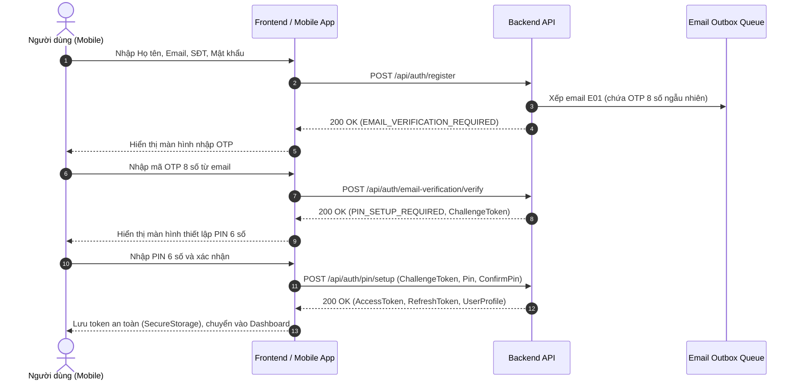
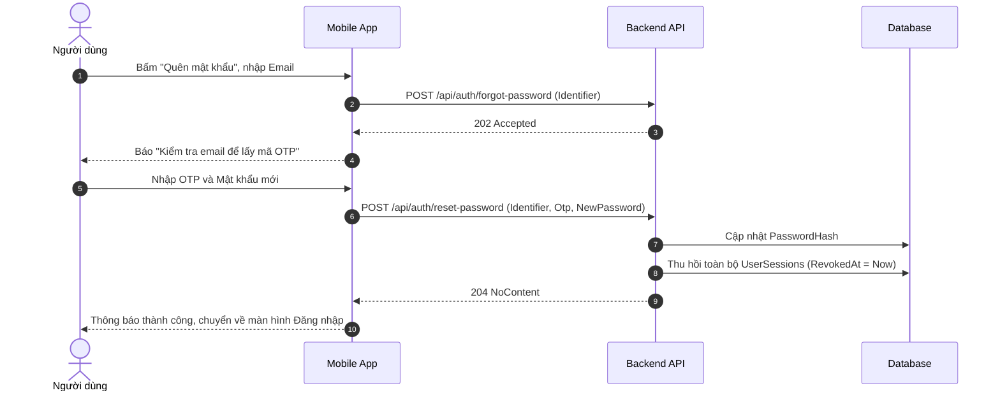
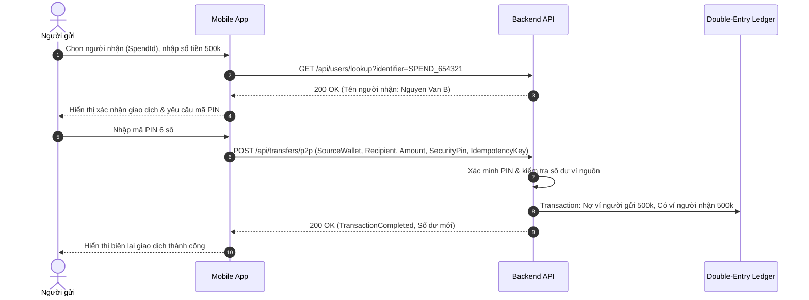

# SPENDWISE V1.0 — ĐẶC TẢ NGHIỆP VỤ VÀ TÀI LIỆU API PHÂN HỆ USER

> **Phiên bản:** V1.0 (Production Candidate)  
> **Phạm vi tài liệu:** Thuần đặc tả nghiệp vụ, quy tắc dữ liệu, API contract và luồng người dùng (User Flows) của phân hệ Người dùng (User Mobile / Web Client).  
> **Trạng thái Backend:** Đã khóa nghiệp vụ (Backend Functional Locked), 100% endpoint được kiểm thử hồi quy tự động.  
> **Ranh giới:** Không chứa triết lý kiến trúc chung, không chứa nội dung tiếp thị hay hướng dẫn framework UI.

---

## 1. QUY TẮC NGHIỆP VỤ CỐT LÕI (CORE BUSINESS RULES)

### 1.1. Vòng đời Tài khoản & Phiên đăng nhập (Account & Session Lifecycle)
1. **Phân quyền Actor:**
   - Người dùng thông thường sở hữu `SystemRole.User = 1`.
   - Các vai trò cũ (`SystemAdmin = 0`, `SuperAdmin = 3`) bị loại bỏ hoàn toàn; token chứa các vai trò này sẽ bị từ chối truy cập ngay lập tức (`403 Forbidden`).
   - Chủ quỹ nhóm (`Fund Owner`) là người dùng thông thường có thêm quyền quản trị trong phạm vi quỹ mình sở hữu, tuyệt đối không có quyền quản trị hệ thống.
2. **Trạng thái tài khoản:**
   - `Active (0)`: Trạng thái bình thường; toàn quyền sử dụng ví, giao dịch, ngân sách, mục tiêu, quỹ nhóm và gửi khiếu nại.
   - `Restricted (1)`: Tài khoản bị giới hạn rủi ro; người dùng vẫn đăng nhập, xem số dư, đọc dữ liệu, nhận tiền P2P và gửi hỗ trợ, nhưng **bị chặn toàn bộ lệnh ghi nợ tiền ra** (chuyển tiền, rút tiền, chi tiêu quỹ, nộp quỹ). Mã lỗi trả về: `403 Forbidden` (`account_restricted`).
   - `Locked (2)`: Tài khoản bị khóa an ninh; toàn bộ Refresh Token và User Session bị thu hồi ngay lập tức (`RevokedAt = UtcNow`). **Chặn hoàn toàn đăng nhập và cấp mới token**. Khi được mở khóa, người dùng bắt buộc phải đăng nhập lại từ đầu.
3. **Mã PIN bảo mật 6 số (`SecurityPin`):**
   - Bắt buộc thiết lập ngay sau khi xác minh email thành công (`PIN_SETUP_REQUIRED`).
   - Mọi thao tác ghi nợ, chuyển tiền, rút tiền, phê duyệt chi quỹ nhóm đều bắt buộc phải cung cấp mã PIN hợp lệ.
   - Khóa tạm thời (`Lockout`) nếu nhập sai quá 5 lần liên tiếp.

### 1.2. Quản lý Ví & Số dư (Wallet Limits & Balances)
1. **Cấu trúc ví:**
   - Mỗi người dùng khi kích hoạt được cấp một Ví chính (`Main Wallet`, mặc định, không thể xóa).
   - Người dùng có thể tạo thêm các Ví phụ (`Sub-wallets`) để phân bổ tài chính.
   - Tổng số dư hiển thị = Tổng số dư khả dụng của Ví chính + các Ví phụ.
2. **Nguyên tắc Sổ cái kép (Double-Entry Ledger):**
   - Mọi biến động số dư phải được ghi nhận đồng thời vào hai tài khoản đối ứng (Nợ / Có).
   - Tổng Nợ luôn bằng Tổng Có ($\sum \text{Debit} = \sum \text{Credit}$).
   - Số dư ví không bao giờ được âm; nếu số dư khả dụng nhỏ hơn số tiền yêu cầu ghi nợ, giao dịch bị từ chối (`insufficient_funds`).
3. **Chống trùng lặp (Idempotency):**
   - Các API biến động số dư yêu cầu gửi kèm `IdempotencyKey` (UUIDv4) và `IdempotencyScope`.
   - Nếu một request gửi lại với cùng key và scope, Backend trả về kết quả đã xử lý trước đó mà không trừ tiền lần hai.

### 1.3. Ngân hàng & Tích hợp Nạp tiền Sandbox (Banking Guard)
1. **Ràng buộc liên kết ngân hàng:**
   - Tên chủ tài khoản ngân hàng liên kết bắt buộc phải trùng khớp (hoặc chuẩn hóa tương đương) với Họ tên định danh của tài khoản SpendWise.
   - Mỗi số tài khoản ngân hàng tại một ngân hàng chỉ được liên kết với một tài khoản người dùng tại một thời điểm.
2. **Chính sách an toàn dòng tiền (Safety Policy):**
   - Hệ thống V1.0 chạy tích hợp Sandbox thông qua SePay BankHub.
   - Nghiêm cấm tạo giao dịch rút tiền hoặc nạp tiền bằng tiền thật khi chưa được phê duyệt hạ tầng ngân hàng sống.
   - Mọi giao dịch nạp tiền Sandbox được xác thực qua chữ ký số Webhook IPN và cập nhật số dư tức thời.

### 1.4. Chuyển tiền Nội bộ P2P (P2P Transfer)
1. **Tìm kiếm người nhận:**
   - Tra cứu qua `SpendId` (mã định danh duy nhất) hoặc số điện thoại.
   - Không thể tự chuyển tiền cho chính mình (`self_transfer_not_allowed`).
   - Người nhận phải ở trạng thái `Active` hoặc `Restricted` (cho phép nhận tiền). Nếu người nhận bị `Locked`, từ chối chuyển tiền.
2. **Quy trình chuyển tiền:**
   - Yêu cầu xác thực mã PIN 6 số.
   - Ghi sổ cái kép: Ghi Nợ (`Debit`) ví người gửi, ghi Có (`Credit`) ví người nhận trong một transaction cô lập (`IsolationLevel.ReadCommitted` hoặc cao hơn).

### 1.5. Quỹ nhóm Cố định V2 (Fixed Group Fund V2)
1. **Cơ chế góp quỹ theo nghĩa vụ (Obligation Model):**
   - Quỹ có chu kỳ (tuần/tháng) và số tiền nghĩa vụ định mức cho mỗi thành viên.
   - Thành viên nộp quỹ để hoàn thành nghĩa vụ của kỳ.
2. **Quy tắc chi tiêu động (`CanSpend`):**
   - Loại bỏ hoàn toàn cơ chế tạm giữ 20% và trạng thái giữ chỗ giả tạo (Pending24h).
   - Công thức hạn mức chi tiêu khả dụng của thành viên:
     $$\text{CanSpend} = \text{Tổng số tiền đã đóng} - \text{Phần nghĩa vụ đã phân bổ/sử dụng}$$
   - Thành viên được cấp quyền `CanSpend` có thể thực hiện chi tiêu trong hạn mức này mà không cần chờ toàn bộ thành viên khác phê duyệt.
   - Chi tiêu vượt quá hạn mức cá nhân phải được Chủ quỹ (`Owner`) phê duyệt đề xuất chi.

### 1.6. Quỹ nhóm Tự do (Free Group Fund)
1. **Cơ chế đóng góp linh hoạt:**
   - Thành viên đóng góp tự nguyện với số tiền tùy ý, không ép buộc định mức kỳ.
2. **Quy trình chi tiêu & Rút vốn:**
   - Mọi thành viên có quyền tạo đề xuất chi tiêu (`Expense Proposal`) hoặc đề xuất rút vốn.
   - Đề xuất phải được Chủ quỹ phê duyệt mới kích hoạt xuất tiền từ quỹ.
   - Bảng kê chi tiêu và biến động quỹ được công khai minh bạch cho toàn bộ thành viên trong quỹ.

### 1.7. Ngân sách Chi tiêu (Budgets)
- Thiết lập hạn mức theo từng Danh mục chi tiêu (`Category`) theo tuần, tháng hoặc năm.
- Ngưỡng cảnh báo tự động khi chi tiêu đạt 80% và 100% ngân sách.
- Giao dịch chi tiêu phát sinh trong danh mục sẽ tự động trừ vào hạn mức ngân sách của chu kỳ tương ứng.

### 1.8. Mục tiêu Tiết kiệm (Savings Goals)
- Thiết lập số tiền mục tiêu (`TargetAmount`) và ngày hoàn thành dự kiến (`TargetDate`).
- Cho phép nạp tiền định kỳ hoặc trích tự động từ Ví chính vào quỹ tích lũy mục tiêu.
- Khi hoàn thành hoặc hủy bỏ, số tiền tích lũy được hoàn trả về Ví chính của người dùng.

### 1.9. Giao dịch Định kỳ (Recurring Transactions)
- Tự động tạo giao dịch định kỳ (ngày, tuần, tháng) cho hóa đơn định kỳ, tiền nhà, lương.
- Thực thi thông qua cơ chế Outbox Worker chạy nền.
- Nếu ví không đủ số dư tại thời điểm thực thi, hệ thống đánh dấu trạng thái `Failed`, gửi thông báo cho người dùng và thử lại theo cấu hình chính sách.

### 1.10. Hỗ trợ & Khiếu nại Trực tiếp (Direct Support & Complaints)
1. **Luồng khiếu nại giao dịch:**
   - Người dùng có quyền gửi khiếu nại (`SupportCase`) trực tiếp từ một giao dịch cụ thể (`TransactionId`).
   - Loại bỏ hoàn toàn endpoint tạo Dispute độc lập trôi nổi ngoài quy trình hỗ trợ.
2. **Vòng đời vụ việc:**
   - `Pending`: Người dùng vừa tạo yêu cầu.
   - `InReview`: Admin đã tiếp nhận và đang thẩm tra.
   - `Resolved`: Admin chấp thuận khiếu nại (hoàn tiền hoặc điều chỉnh trạng thái).
   - `Rejected`: Admin từ chối khiếu nại kèm lý do chính thức.
   - Người dùng và Admin có thể trao đổi tin nhắn, đính kèm bằng chứng bên trong vụ việc.

---

## 2. DANH MỤC API PHÂN HỆ USER (API SPECIFICATIONS)

Mọi request yêu cầu Header:
```http
Content-Type: application/json
Authorization: Bearer <access_token> (trừ các endpoint xác thực công khai)
X-Idempotency-Key: <uuid> (đối với các lệnh ghi biến động số dư)
```

### 2.1. Phân hệ Xác thực & Định danh (Authentication)

#### `POST /api/auth/register`
- **Mô tả:** Đăng ký tài khoản mới. Hệ thống tạo User ở trạng thái chưa xác minh, sinh mã dynamic OTP ngẫu nhiên 8 số và xếp email E01 vào hàng đợi Outbox mã hóa.
- **Quyền:** Public.
- **Request Body:**
```json
{
  "fullName": "Nguyen Van A",
  "email": "user@example.com",
  "phone": "0912345678",
  "password": "Password123!",
  "confirmPassword": "Password123!"
}
```
- **Response `200 OK`:**
```json
{
  "status": "EMAIL_VERIFICATION_REQUIRED",
  "email": "user@example.com",
  "resendAfterSeconds": 60
}
```
- **Mã lỗi:** `400 BadRequest` (`email_already_exists`, `invalid_phone_format`, `password_too_weak`).

#### `POST /api/auth/email-verification/verify`
- **Mô tả:** Xác minh mã OTP 8 số từ email. Mã OTP chỉ dùng một lần (single-use), chống replay.
- **Quyền:** Public.
- **Request Body:**
```json
{
  "email": "user@example.com",
  "otp": "83749201"
}
```
- **Response `200 OK`:**
```json
{
  "status": "PIN_SETUP_REQUIRED",
  "challengeToken": "signed-token-string",
  "expiresIn": 900
}
```
- **Mã lỗi:** `400 BadRequest` (`email_verification_failed`, `otp_expired`, `otp_already_used`, `too_many_failed_attempts`).

#### `POST /api/auth/email-verification/resend`
- **Mô tả:** Gửi lại mã OTP qua email. Mã OTP cũ bị thu hồi ngay lập tức. Áp dụng cooldown 60 giây.
- **Quyền:** Public.
- **Request Body:**
```json
{
  "email": "user@example.com"
}
```
- **Response `200 OK`:**
```json
{
  "status": "EMAIL_VERIFICATION_REQUIRED",
  "resendAfterSeconds": 60
}
```
- **Mã lỗi:** `429 TooManyRequests` (`resend_cooldown_active`).

#### `POST /api/auth/pin/setup`
- **Mô tả:** Thiết lập mã PIN bảo mật 6 số lần đầu tiên sau khi xác minh email. Hoàn tất chu trình onboarding và cấp JWT token.
- **Quyền:** Public (kèm `ChallengeToken`).
- **Request Body:**
```json
{
  "challengeToken": "signed-token-string",
  "pin": "{ securityPin }",
  "confirmPin": "{ securityPin }"
}
```
- **Response `200 OK`:**
```json
{
  "accessToken": "jwt-token-string",
  "refreshToken": "refresh-token-string",
  "expiresIn": 3600,
  "user": {
    "id": "uuid",
    "email": "user@example.com",
    "fullName": "Nguyen Van A",
    "spendId": "SPEND_123456",
    "status": "Active"
  }
}
```

#### `POST /api/auth/login`
- **Mô tả:** Bước 1 đăng nhập bằng Email/SpendId và mật khẩu. Nếu đúng, trả về ChallengeToken yêu cầu nhập mã PIN.
- **Quyền:** Public.
- **Request Body:**
```json
{
  "identifier": "user@example.com",
  "password": "Password123!",
  "deviceName": "iPhone 15 Pro"
}
```
- **Response `200 OK`:**
```json
{
  "status": "PIN_REQUIRED",
  "challengeToken": "signed-challenge-token",
  "expiresIn": 300
}
```
- **Mã lỗi:** `401 Unauthorized` (`invalid_credentials`), `403 Forbidden` (`account_locked`).

#### `POST /api/auth/pin/verify`
- **Mô tả:** Bước 2 đăng nhập bằng mã PIN 6 số. Cấp Access Token và Refresh Token.
- **Quyền:** Public (kèm `ChallengeToken`).
- **Request Body:**
```json
{
  "challengeToken": "signed-challenge-token",
  "pin": "{ securityPin }",
  "deviceName": "iPhone 15 Pro"
}
```
- **Response `200 OK`:**
```json
{
  "accessToken": "jwt-token-string",
  "refreshToken": "refresh-token-string",
  "expiresIn": 3600,
  "user": {
    "id": "uuid",
    "email": "user@example.com",
    "fullName": "Nguyen Van A",
    "spendId": "SPEND_123456",
    "status": "Active"
  }
}
```
- **Mã lỗi:** `400 BadRequest` (`invalid_pin`), `429 TooManyRequests` (`pin_temporarily_locked`).

#### `POST /api/auth/refresh`
- **Mô tả:** Cấp mới Access Token bằng Refresh Token (Token Rotation).
- **Quyền:** Public.
- **Request Body:**
```json
{
  "refreshToken": "current-refresh-token"
}
```
- **Response `200 OK`:** Trả về bộ token mới. Refresh token cũ bị vô hiệu hóa.
- **Mã lỗi:** `401 Unauthorized` (`token_revoked`, `token_expired`).

#### `POST /api/auth/logout`
- **Mô tả:** Đăng xuất phiên hiện tại, thu hồi refresh token tương ứng.
- **Quyền:** User.
- **Response `204 NoContent`**

#### `POST /api/auth/forgot-password`
- **Mô tả:** Yêu cầu đặt lại mật khẩu. Gửi dynamic OTP 8 số tới email đã đăng ký.
- **Quyền:** Public.
- **Request Body:**
```json
{
  "identifier": "user@example.com"
}
```
- **Response `202 Accepted`**

#### `POST /api/auth/reset-password`
- **Mô tả:** Đặt lại mật khẩu mới bằng mã OTP. Tự động thu hồi toàn bộ phiên hoạt động cũ (`UserSessions`).
- **Quyền:** Public.
- **Request Body:**
```json
{
  "identifier": "user@example.com",
  "otp": "83749201",
  "newPassword": "NewPassword123!"
}
```
- **Response `204 NoContent`**

#### `POST /api/auth/pin/forgot`
- **Mô tả:** Yêu cầu khôi phục mã PIN. Hệ thống gửi email chứa signed reset link bảo mật.
- **Quyền:** Public.
- **Request Body:**
```json
{
  "identifier": "user@example.com"
}
```
- **Response `202 Accepted`**

#### `POST /api/auth/pin/reset`
- **Mô tả:** Đặt lại mã PIN bằng signed token từ email. Mã token chỉ dùng một lần.
- **Quyền:** Public.
- **Request Body:**
```json
{
  "token": "raw-token-from-email-link",
  "newPin": "{ securityPin }",
  "confirmPin": "{ securityPin }"
}
```
- **Response `204 NoContent`**
- **Mã lỗi:** `401 Unauthorized` (`token_invalid_or_expired`, `token_already_used`).

---

### 2.2. Hồ sơ Người dùng & Tùy chọn (User Profile & Preferences)

#### `GET /api/users/me`
- **Mô tả:** Lấy thông tin chi tiết người dùng hiện tại, bao gồm số dư ví chính, trạng thái tài khoản.
- **Quyền:** User.
- **Response `200 OK`:**
```json
{
  "id": "uuid",
  "email": "user@example.com",
  "fullName": "Nguyen Van A",
  "phone": "0912345678",
  "spendId": "SPEND_123456",
  "status": "Active",
  "mainWalletBalance": 5000000.00,
  "createdAt": "2026-10-20T10:00:00Z"
}
```

#### `PUT /api/users/me/preferences`
- **Mô tả:** Lưu tùy chọn giao diện người dùng (chủ đề, ngôn ngữ hiển thị).
- **Quyền:** User.
- **Request Body:**
```json
{
  "theme": "dark",
  "locale": "vi-VN",
  "enableBiometric": true,
  "notificationsEnabled": true
}
```
- **Response `200 OK`:** Trả về đối tượng preferences đã cập nhật.

#### `POST /api/users/me/email/request`
- **Mô tả:** Yêu cầu đổi địa chỉ email. Gửi dynamic OTP tới email mới và gửi thông báo cảnh báo tới email cũ.
- **Quyền:** User.
- **Request Body:**
```json
{
  "newEmail": "new_email@example.com"
}
```
- **Response `200 OK`:** `{ "status": "CONFIRMATION_REQUIRED", "resendAfterSeconds": 60 }`

#### `POST /api/users/me/email/confirm`
- **Mô tả:** Xác nhận đổi email bằng mã OTP nhận được tại hộp thư mới.
- **Quyền:** User.
- **Request Body:**
```json
{
  "newEmail": "new_email@example.com",
  "otp": "94820153"
}
```
- **Response `200 OK`:** Trả về hồ sơ người dùng với email mới.

---

### 2.3. Phân hệ Ví & Giao dịch Tài chính (Wallets & Transactions)

#### `GET /api/wallets`
- **Mô tả:** Lấy danh sách ví của người dùng (Ví chính và các Ví phụ).
- **Quyền:** User.
- **Response `200 OK`:**
```json
[
  {
    "id": "uuid-main",
    "name": "Ví chính",
    "type": "Main",
    "balance": 5000000.00,
    "isDefault": true
  },
  {
    "id": "uuid-sub",
    "name": "Ví du lịch",
    "type": "Sub",
    "balance": 2000000.00,
    "isDefault": false
  }
]
```

#### `POST /api/wallets`
- **Mô tả:** Tạo ví phụ mới.
- **Quyền:** User (chỉ `Active`).
- **Request Body:**
```json
{
  "name": "Quỹ mua sắm",
  "initialBalance": 0
}
```
- **Response `201 Created`**

#### `POST /api/transfers/p2p`
- **Mô tả:** Chuyển tiền nội bộ cho người dùng khác trong hệ thống qua SpendId hoặc số điện thoại.
- **Quyền:** User (`Active`; nếu `Restricted` bị chặn `403`).
- **Request Body:**
```json
{
  "recipientIdentifier": "SPEND_654321",
  "amount": 250000.00,
  "sourceWalletId": "uuid-main",
  "note": "Tiền ăn tối",
  "securityPin": "{ securityPin }"
}
```
- **Response `200 OK`:**
```json
{
  "transactionId": "uuid-tx",
  "status": "Completed",
  "amount": 250000.00,
  "sourceBalanceAfter": 4750000.00,
  "timestamp": "2026-10-29T14:00:00Z"
}
```
- **Mã lỗi:** `400 BadRequest` (`insufficient_funds`, `invalid_recipient`, `invalid_security_pin`), `403 Forbidden` (`account_restricted`).

#### `GET /api/transactions`
- **Mô tả:** Lịch sử giao dịch cá nhân có phân trang, bộ lọc thời gian, loại giao dịch, danh mục.
- **Quyền:** User.
- **Query Params:** `page=1&pageSize=20&type=Transfer&fromDate=2026-10-01`
- **Response `200 OK`:** Danh sách giao dịch kèm thông tin phân trang.

#### `POST /api/transactions/expense`
- **Mô tả:** Ghi nhận khoản chi tiêu cá nhân (rút khỏi ví, ghi nhận danh mục để trừ ngân sách).
- **Quyền:** User (`Active`).
- **Request Body:**
```json
{
  "walletId": "uuid-main",
  "categoryId": "uuid-category-food",
  "amount": 120000.00,
  "transactionDate": "2026-10-29T14:30:00Z",
  "note": "Cà phê sáng"
}
```
- **Response `201 Created`**

#### `POST /api/banking/sepay/deposit-intent`
- **Mô tả:** Tạo ý định nạp tiền qua cổng ngân hàng SePay (Sandbox). Trả về thông tin chuyển khoản (QR code / số tài khoản / cú pháp nội dung).
- **Quyền:** User (`Active`).
- **Request Body:**
```json
{
  "walletId": "uuid-main",
  "amount": 1000000.00
}
```
- **Response `200 OK`:**
```json
{
  "depositReference": "SPEND_DEP_123456",
  "bankCode": "MB",
  "accountNumber": "0912345678",
  "accountName": "SPENDWISE SANDBOX",
  "amount": 1000000.00,
  "transferCode": "SE_DEP_123456",
  "qrUrl": "https://img.vietqr.io/image/MB-0912345678-compact2.png"
}
```

---

### 2.4. Phân hệ Quỹ Nhóm (Group Funds)

#### `POST /api/funds/fixed`
- **Mô tả:** Tạo quỹ nhóm Cố định V2.
- **Quyền:** User (`Active`).
- **Request Body:**
```json
{
  "name": "Quỹ Nhà Trọ 402",
  "description": "Quỹ sinh hoạt chung",
  "period": "Monthly",
  "obligationAmount": 500000.00
}
```
- **Response `201 Created`**

#### `POST /api/funds/free`
- **Mô tả:** Tạo quỹ nhóm Tự do (linh hoạt, tự nguyện).
- **Quyền:** User (`Active`).
- **Request Body:**
```json
{
  "name": "Quỹ Du Lịch Hè 2026",
  "description": "Góp quỹ linh hoạt"
}
```
- **Response `201 Created`**

#### `POST /api/funds/{fundId}/members`
- **Mô tả:** Mời thành viên vào quỹ bằng SpendId hoặc Email.
- **Quyền:** Chủ quỹ (`Fund Owner`).
- **Request Body:**
```json
{
  "memberIdentifier": "SPEND_789012"
}
```
- **Response `200 OK`**

#### `POST /api/funds/{fundId}/contributions`
- **Mô tả:** Đóng tiền vào quỹ từ Ví chính của thành viên.
- **Quyền:** Thành viên quỹ (`Active`).
- **Request Body:**
```json
{
  "sourceWalletId": "uuid-main",
  "amount": 500000.00,
  "securityPin": "{ securityPin }"
}
```
- **Response `200 OK`**

#### `GET /api/funds/{fundId}/can-spend`
- **Mô tả:** Kiểm tra hạn mức chi tiêu khả dụng (`CanSpend`) của thành viên trong Quỹ Cố định V2.
- **Quyền:** Thành viên quỹ.
- **Response `200 OK`:**
```json
{
  "fundId": "uuid-fund",
  "userId": "uuid-user",
  "totalContributed": 1500000.00,
  "allocatedObligation": 1000000.00,
  "canSpendAmount": 500000.00
}
```

#### `POST /api/funds/{fundId}/proposals`
- **Mô tả:** Tạo đề xuất chi tiêu hoặc rút tiền từ quỹ (áp dụng cho Quỹ Tự do hoặc chi vượt hạn mức Quỹ Cố định).
- **Quyền:** Thành viên quỹ.
- **Request Body:**
```json
{
  "title": "Mua bình nóng lạnh",
  "amount": 1800000.00,
  "description": "Thay bình nước nóng bị hỏng phòng tắm",
  "recipientWalletId": "uuid-member-wallet"
}
```
- **Response `201 Created`**

#### `POST /api/funds/{fundId}/proposals/{proposalId}/review`
- **Mô tả:** Chủ quỹ phê duyệt hoặc từ chối đề xuất chi.
- **Quyền:** Chủ quỹ (`Fund Owner`).
- **Request Body:**
```json
{
  "action": "Approve",
  "reviewNote": "Đồng ý thay mới",
  "securityPin": "{ securityPin }"
}
```
- **Response `200 OK`:** Trạng thái đề xuất chuyển thành `Approved`, kích hoạt lệnh chuyển tiền từ quỹ đến người nhận.

---

### 2.5. Phân hệ Ngân sách & Mục tiêu (Budgets & Goals)

#### `POST /api/budgets`
- **Mô tả:** Tạo ngân sách chi tiêu cho danh mục theo kỳ.
- **Quyền:** User (`Active`).
- **Request Body:**
```json
{
  "categoryId": "uuid-category",
  "limitAmount": 3000000.00,
  "period": "Monthly",
  "startDate": "2026-11-01"
}
```
- **Response `201 Created`**

#### `GET /api/budgets/progress`
- **Mô tả:** Theo dõi tiến độ chi tiêu so với ngân sách của các danh mục trong tháng.
- **Quyền:** User.
- **Response `200 OK`:** Danh sách tiến độ theo tỷ lệ % và số tiền đã chi/còn lại.

#### `POST /api/goals`
- **Mô tả:** Tạo mục tiêu tiết kiệm.
- **Quyền:** User (`Active`).
- **Request Body:**
```json
{
  "title": "Mua Laptop mới",
  "targetAmount": 25000000.00,
  "targetDate": "2026-12-31"
}
```
- **Response `201 Created`**

#### `POST /api/goals/{goalId}/deposit`
- **Mô tả:** Nạp tiền vào mục tiêu tiết kiệm từ Ví chính.
- **Quyền:** User (`Active`).
- **Request Body:**
```json
{
  "sourceWalletId": "uuid-main",
  "amount": 2000000.00,
  "securityPin": "{ securityPin }"
}
```
- **Response `200 OK`**

---

### 2.6. Phân hệ Giao dịch Định kỳ (Recurring Transactions)

#### `POST /api/recurring-transactions`
- **Mô tả:** Thiết lập giao dịch tự động định kỳ.
- **Quyền:** User (`Active`).
- **Request Body:**
```json
{
  "walletId": "uuid-main",
  "categoryId": "uuid-category-rent",
  "amount": 4000000.00,
  "interval": "Monthly",
  "dayOfMonth": 5,
  "description": "Tiền nhà trọ định kỳ hàng tháng"
}
```
- **Response `201 Created`**

---

### 2.7. Phân hệ Hỗ trợ & Khiếu nại Giao dịch (Support & Complaints)

#### `POST /api/v1/support/cases`
- **Mô tả:** Gửi yêu cầu hỗ trợ hoặc khiếu nại trực tiếp liên quan đến một giao dịch tài chính.
- **Quyền:** User (`Active` hoặc `Restricted`).
- **Request Body:**
```json
{
  "transactionId": "uuid-tx-disputed",
  "title": "Chuyển tiền bị trừ 2 lần",
  "description": "Giao dịch lúc 14:02 bị timeout nhưng tài khoản trừ tiền 2 lần",
  "category": "TransactionIssue"
}
```
- **Response `201 Created`:**
```json
{
  "caseId": "uuid-case",
  "status": "Pending",
  "transactionId": "uuid-tx-disputed",
  "createdAt": "2026-10-29T14:40:00Z"
}
```

#### `GET /api/v1/support/cases`
- **Mô tả:** Xem danh sách các yêu cầu hỗ trợ/khiếu nại của chính mình.
- **Quyền:** User.
- **Response `200 OK`**

#### `POST /api/v1/support/cases/{caseId}/messages`
- **Mô tả:** Gửi thêm phản hồi, cung cấp thông tin/bằng chứng cho vụ việc đang xử lý.
- **Quyền:** User (sở hữu `caseId`).
- **Request Body:**
```json
{
  "message": "Tôi xin gửi kèm mã tham chiếu đối soát ngân hàng: REF987654"
}
```
- **Response `200 OK`**

---

### 2.8. Phân hệ Trợ lý Tài chính AI (AI Assistant — Phương án B)

#### `POST /api/ai/conversations`
- **Mô tả:** Tạo phiên hội thoại tư vấn tài chính mới với AI.
- **Quyền:** User.
- **Response `201 Created`:** `{ "conversationId": "uuid-conv" }`

#### `POST /api/ai/conversations/{convId}/messages`
- **Mô tả:** Gửi tin nhắn hỏi đáp phân tích chi tiêu, gợi ý tiết kiệm. Tự động chuyển mạch sang chính sách quy tắc nội bộ (`SpendWisePolicy`) nếu Gemini API vượt hạn ngạch hoặc mất kết nối.
- **Quyền:** User.
- **Request Body:**
```json
{
  "message": "Tháng này tôi chi bao nhiêu tiền cho ăn uống và có vượt ngân sách không?"
}
```
- **Response `200 OK`:**
```json
{
  "reply": "Trong tháng này, bạn đã chi 3.200.000 VNĐ cho danh mục Ăn uống, đạt 106% ngân sách (3.000.000 VNĐ). Bạn nên cân đối chi tiêu các ngày còn lại.",
  "provider": "Gemini_Live"
}
```

---

## 3. CÁC LUỒNG NGƯỜI DÙNG TIÊU BIỂU (STEP-BY-STEP USER FLOWS)

### Flow 1: Đăng ký $\rightarrow$ Xác minh Email $\rightarrow$ Tạo PIN $\rightarrow$ Đăng nhập


### Flow 2: Quên mật khẩu $\rightarrow$ Dynamic OTP $\rightarrow$ Đổi mật khẩu $\rightarrow$ Thu hồi phiên


### Flow 3: Chuyển tiền P2P nội bộ (Bảo vệ PIN & Sổ cái kép)


---

## 4. RANH GIỚI TRÁCH NHIỆM FRONTEND / MOBILE APP

Để bảo đảm tính tách bạch kiến trúc, Frontend/Mobile chịu trách nhiệm toàn bộ các phần việc sau:

1. **Giao diện & Trải nghiệm Trực quan (UI/UX):**
   - Triển khai 3 chủ đề: Sáng (`light`), Tối (`dark`), Theo hệ điều hành (`system`).
   - Quản lý bộ chuỗi đa ngôn ngữ (Localization Strings) cho Tiếng Việt (`vi-VN`) và Tiếng Anh (`en-US`).
   - Xử lý hoạt ảnh chuyển cảnh (animations), loading skeleton, toast thông báo lỗi thân thiện.
2. **Sinh trắc học Native Phần cứng (Biometrics):**
   - Gọi API native của thiết bị (Face ID / Touch ID trên iOS qua `LocalAuthentication`; Fingerprint / BiometricPrompt trên Android).
   - Quản lý khóa WebAuthn/FIDO2 trên phần cứng an toàn (Secure Enclave / Keystore).
   - Backend chỉ nhận chữ ký số mật mã hoặc Challenge Token, không can thiệp vào UI cảm biến vân tay/khuôn mặt native.
3. **Quản lý Lưu trữ Bảo mật (Client Secure Storage):**
   - Lưu trữ `accessToken` trong bộ nhớ RAM hoặc Keystore/Keychain mã hóa.
   - Quản lý `refreshToken` an toàn, tự động gọi API refresh ngầm trước khi token hết hạn.
   - Xóa sạch toàn bộ token và bộ nhớ đệm khi nhận lỗi `401 Unauthorized` hoặc người dùng chủ động Đăng xuất.
4. **Xử lý Mất kết nối & Idempotency:**
   - Tạo khóa `IdempotencyKey` ngẫu nhiên chuẩn UUIDv4 cho mỗi lệnh bấm chuyển tiền / thanh toán để chống gửi đúp khi mạng gián đoạn.
   - Hiển thị banner trạng thái offline khi mất kết nối mạng.
