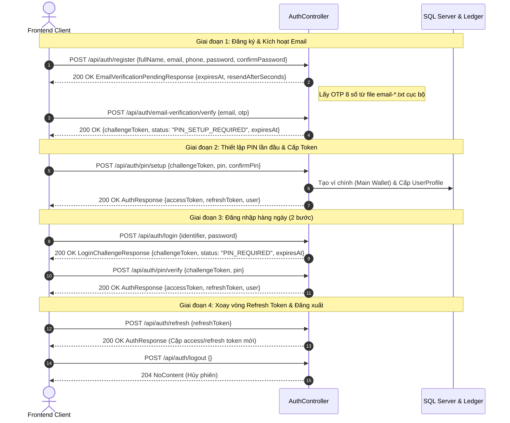
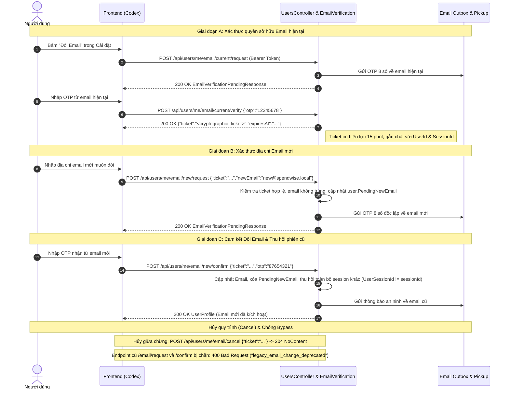

# SPENDWISE V1.0 — TÀI LIỆU BÀN GIAO KỸ THUẬT BACKEND CHO ĐỘI NGŨ CODEX
> **Dành riêng cho:** Codex & Kỹ sư tích hợp Frontend (Google AI Studio Prototype $\rightarrow$ Client Web/Mobile)
> **Phiên bản Backend:** SpendWise V1.0 (Production Candidate)
> **Commit Baseline:** `663099328d7ffc5a497ffe3659e5ed4e6df52522` (Backend Locked)
> **Thời điểm bàn giao:** 23:00 Ngày 03/11/2026

---

## 1. TỔNG QUAN & RANH GIỚI BÀN GIAO

1. **Trạng thái Backend:**
   - Nguồn Backend khóa tại `53b6d6e`; trạng thái khóa source không đồng nghĩa với xác minh 100% hợp đồng API.
   - Toàn bộ các bộ kiểm thử cốt lõi đã đạt kết quả tuyệt đối:
     - **User API Suite:** 306 requests / 343 assertions PASS (`reports/newman/SpendWise-User-API-REPORT-LIVE.json`).
     - **Admin API Suite:** 80 requests / 138 assertions PASS (`reports/newman/ADMIN-V1-FINAL-NEWMAN-REPORT-LIVE.json`).
     - **Support Cross-Role Suite:** 22 requests / 42 assertions PASS (`reports/newman/support_complaint_e2e_regression_report.json`).
     - **Fixed Fund V2 & Free Fund V1:** 116 requests / 116 assertions PASS (`reports/newman/spendwise_e2e_comprehensive_report.json`).
     - **Isolated xUnit Unit/Integration:** 174/174 tests PASS (`reports/xunit/final_isolated_acceptance.trx`).
     - **Cơ sở dữ liệu chính:** `SpendWiseDb` trên SQL Server `DESKTOP-B5KA3LT\SQLEXPRESS01` đã áp dụng đủ 45/45 EF Core migrations.
2. **Ranh giới công việc Frontend:**
   - Mã nguồn trong thư mục `frontend/` là phiên bản thử nghiệm cũ, **KHÔNG PHẢI** giao diện chính thức.
   - Product Owner đang thiết kế lại giao diện trong **Google AI Studio**.
   - Nhiệm vụ của Codex: Nhận code/prototype giao diện từ Google AI Studio, tổ chức dự án frontend và tích hợp trực tiếp vào hệ thống API Backend hiện hành theo tài liệu này.
   - Tuyệt đối không yêu cầu Backend thay đổi quy tắc kế toán sổ cái hoặc DTO đã khóa.

---

## 2. THÔNG SỐ RUNTIME & MÔI TRƯỜNG PHÁT TRIỂN (RUNTIME & ENVIRONMENT)

### 2.1. Cấu hình Cổng & Địa chỉ Dịch vụ
- **Backend HTTPS (Khuyến nghị cho Web & Mobile):** `https://localhost:7256`
- **Backend HTTP (Development Loopback):** `http://localhost:5159`
  *(Lưu ý: Mọi request HTTP thông thường sẽ tự động chuyển hướng sang HTTPS qua `UseHttpsRedirection`, trừ khi chạy profile AdminE2E).*
- **API Base URL:** `https://localhost:7256/api`
- **OpenAPI 3.0 Contract Specification:** `GET https://localhost:7256/openapi/v1.json`
- **Health Check Endpoints:**
  - `GET https://localhost:7256/health` (Kiểm tra tổng thể Database + Workers)
  - `GET https://localhost:7256/health/ready` (Sẵn sàng phục vụ traffic)
  - `GET https://localhost:7256/health/live` (Tiến trình đang sống)
- **Môi trường:** `ASPNETCORE_ENVIRONMENT = Development`
- **Database chính:** Microsoft SQL Server `DESKTOP-B5KA3LT\SQLEXPRESS01` — Database `SpendWiseDb`.
- **Email trong Development:** Sử dụng chế độ **Local Pickup** (`EmailDeliveryMode.Pickup`). Khi đăng ký hoặc quên mật khẩu, email OTP 8 số sẽ được ghi thành file `email-*.txt` cục bộ (mặc định tại `AppContext.BaseDirectory/password-reset-pickup`, hoặc ghi đè qua cấu hình `PasswordReset:PickupDirectory`), không gửi email ra ngoài Internet và không lưu file `.eml`.

---

## 3. CƠ CHẾ CORS & KẾT NỐI VỚI GOOGLE AI STUDIO

### 3.1. Rào cản mạng khi chạy trực tiếp trên Google AI Studio
- Giao diện thiết kế trên **Google AI Studio** chạy trên hạ tầng đám mây của Google (`https://aistudio.google.com`).
- Do chính sách an ninh của trình duyệt (**Same-Origin Policy** và **Mixed Content / Private Network Access**):
  - Trình duyệt chạy trên trang web đám mây (`https://aistudio.google.com`) **KHÔNG THỂ trực tiếp gọi API tới `https://localhost:7256`** trên máy tính của bạn.
- **Quy trình tích hợp chuẩn cho Codex:**
  1. Thiết kế và tinh chỉnh giao diện, luồng màn hình trên Google AI Studio.
  2. Xuất mã nguồn giao diện (React / Vite / Next.js) về máy phát triển cục bộ.
  3. Chạy frontend tại máy cục bộ (ví dụ: `http://localhost:3000` hoặc `http://localhost:5173`).
  4. Cấu hình Backend cho phép nguồn gốc này thông qua mục `AllowedOrigins`.

### 3.2. Cấu hình AllowedOrigins trong Backend
Trong file `backend/SpendWise/appsettings.Development.json` (hoặc thông qua biến môi trường):
```json
{
  "AllowedOrigins": [
    "http://localhost:3000",
    "http://localhost:5173"
  ]
}
```
> [!WARNING]
> Tuyệt đối không cấu hình CORS mở tự do toàn bộ Internet (`*`) kèm `AllowCredentials()` vì vi phạm chính sách an ninh trình duyệt và bảo mật tài chính.

---

## 4. HỢP ĐỒNG XÁC THỰC & BẢO MẬT (AUTHENTICATION CONTRACT)

Hệ thống quản lý định danh nghiêm ngặt dựa trên JWT Access Token (ngắn hạn), Refresh Token (xoay vòng), và mã PIN giao dịch.

### 4.1. Phân biệt hai vai trò duy nhất trong hệ thống
- **Vai trò `User` (`SystemRole = 1`):** Khách hàng sử dụng ứng dụng di động / web cá nhân.
- **Vai trò `Admin` (`SystemRole = 2`):** Quản trị viên hệ thống duy nhất (`<email Admin được cấu hình>`).
- *(Các vai trò cũ `SystemAdmin = 0` và `SuperAdmin = 3` bị từ chối truy cập ngay tại tầng bảo mật với mã lỗi `403 Forbidden - legacy_role_rejected`).*

### 4.2. Luồng xác thực người dùng (Step-by-Step Flow)



### 4.3. Giá trị chuẩn của LoginChallengeResponse.Status & Phân biệt kiểm tra mã PIN
- **Mã trạng thái chuẩn của Challenge (`status`):**
  - `"PIN_SETUP_REQUIRED"`: Tài khoản vừa kích hoạt email, chưa có PIN; client chuyển hướng sang màn hình thiết lập PIN lần đầu (`POST /api/auth/pin/setup`).
  - `"PIN_REQUIRED"`: Tài khoản đã có PIN; client yêu cầu nhập PIN 6 số để hoàn tất đăng nhập (`POST /api/auth/pin/verify`).
  - *(Lưu ý: Backend đối chiếu trực tiếp `LoginChallengeSupport.cs`, không bao giờ trả về camelCase như `PinSetupRequired`).*
- **Phân biệt hai endpoint kiểm tra mã PIN:**
  1. `POST /api/auth/pin/verify`: **Bước 2 của Đăng nhập**. Nhận `challengeToken` + `pin` $\rightarrow$ Trả về `AuthResponse` (Access token mới).
  2. `POST /api/security-pin/verify`: **Xác thực trước khi giao dịch tài chính**. Nhận `pin` $\rightarrow$ Trả về `204 NoContent`. Không cấp token mới.

### 4.4. Quy trình Đổi Email Bảo mật 3 Giai đoạn (Airtight 3-Stage Email Change Flow)

Nhằm ngăn chặn triệt để lỗ hổng chiếm đoạt tài khoản (Account Takeover), backend áp dụng quy trình xác minh 3 giai đoạn độc lập:



| Giai đoạn | Phương thức | Endpoint | Request Body | Phản hồi & Ý nghĩa bảo mật |
|---|---|---|---|---|
| **A1** | `POST` | `/api/users/me/email/current/request` | Không body | `200 OK` $\rightarrow$ `EmailVerificationPendingResponse`. Gửi OTP 8 số về email hiện tại. |
| **A2** | `POST` | `/api/users/me/email/current/verify` | `{"otp":"12345678"}` | `200 OK` $\rightarrow$ `{"ticket":"...","expiresAt":"..."}`. Cấp ticket 15 phút gắn chặt với phiên và tài khoản. |
| **B** | `POST` | `/api/users/me/email/new/request` | `{"ticket":"...","newEmail":"new@email.com"}` | `200 OK` $\rightarrow$ `EmailVerificationPendingResponse`. Gửi OTP 8 số về email mới; ghi nhận `PendingNewEmail`. |
| **C** | `POST` | `/api/users/me/email/new/confirm` | `{"ticket":"...","otp":"87654321"}` | `200 OK` $\rightarrow$ `UserProfile`. Commit đổi email, thu hồi toàn bộ session khác, gửi cảnh báo về email cũ. |
| **Hủy** | `POST` | `/api/users/me/email/cancel` | `{"ticket":"..."}` (tùy chọn) | `204 NoContent`. Thu hồi mọi token đổi email chưa dùng của tài khoản và xóa `PendingNewEmail`; ticket không thu hẹp phạm vi. |
| **Chặn** | `POST` | `/api/users/me/email/request` & `/confirm` | Bất kỳ | `400 Bad Request` (`code: "legacy_email_change_deprecated"`). Chặn hoàn toàn bypass quy trình cũ. |

---

## 5. BẢN ĐỒ API PHÂN HỆ USER CHO CODEX (CORE USER APIS)

Header bắt buộc cho các API bảo mật:
```http
Authorization: Bearer <accessToken>
Content-Type: application/json
```

### 5.1. Ví cá nhân & Danh mục (Wallets & Categories)
| Phương thức | Đường dẫn API | Request Body tóm tắt | Response & Mã HTTP | Frontend xử lý |
|---|---|---|---|---|
| `GET` | `/api/wallets` | Không | `WalletDto[]` (`availableBalance, type, status`) | Hiển thị danh sách ví. Giới hạn tối đa 3 ví cá nhân. |
| `POST` | `/api/wallets` | `{"name":"Ví tiết kiệm","type":"Sub","isDefault":false}` | `201 Created` $\rightarrow$ `WalletDto` | Tạo ví phụ. Không cho client tự tạo ví Main. |
| `DELETE` | `/api/wallets/{id}` | Không | `204 NoContent` | Đóng ví. Ví đã đóng vẫn tính vào giới hạn 3 ví. |
| `GET` | `/api/categories` | Không | `CategoryDto[]` (`id, name, kind, icon, color`) | Danh mục thu/chi dùng cho dropdown. |

### 5.2. Thu / Chi & Sổ cái cá nhân (Transactions & Evidence)
| Phương thức | Đường dẫn API | Request Body tóm tắt | Response & Mã HTTP | Frontend xử lý |
|---|---|---|---|---|
| `GET` | `/api/transactions` | Query: `page=1&pageSize=20&walletId=...&from=...&to=...` | `PagedResult<TransactionDto>` | Danh sách lịch sử biến động số dư. |
| `POST` | `/api/transactions/income` | `{"walletId":"uuid","categoryId":"uuid","amount":500000,"description":"Lương","idempotencyKey":"key","securityPin":"123456"}` | `201 Created` $\rightarrow$ `TransactionDto` | Ghi nhận tiền vào ví chính xác qua sổ cái kép. |
| `POST` | `/api/transactions/expense` | `{"walletId":"uuid","categoryId":"uuid","amount":200000,"description":"Ăn tối","idempotencyKey":"key","securityPin":"123456"}` | `201 Created` $\rightarrow$ `TransactionDto` | Ghi nợ ví. Kiểm tra số dư khả dụng trước khi gọi. |
| `POST` | `/api/transactions/expense/multi-wallet` | `{"amount":300000,"walletAllocations":[{"walletId":"id1","amount":200000},{"walletId":"id2","amount":100000}],"categoryId":"uuid","description":"Chi chung"}` | `201 Created` $\rightarrow$ `TransactionDto` | Chi tiêu trừ tiền trên nhiều ví; tổng phân bổ phải khớp đúng số tiền. |
| `PATCH` | `/api/transactions/{id}` | `{"categoryId":"uuid","description":"Sửa lại ghi chú","securityPin":"123456"}` | `200 OK` $\rightarrow$ `TransactionDto` | Chỉnh sửa giao dịch; backend thực hiện correction có bút toán đảo. |
| `POST` | `/api/evidence` | Multipart Form-Data (key `file`, max 10MB) | `201 Created` $\rightarrow$ `EvidenceDto` (`id, contentHash`) | Upload hóa đơn/chứng từ, lấy `evidenceId` gắn vào giao dịch. |

### 5.3. Chuyển tiền (Transfers)
- **Chuyển nội bộ giữa các ví:** `POST /api/transfers/internal`
  `{"sourceWalletId":"uuid","destinationWalletId":"uuid","amount":100000,"description":"Chuyển tiền tiết kiệm","idempotencyKey":"key","securityPin":"123456"}`
  $\rightarrow$ `201 Created`: Quyết toán tức thì qua sổ cái nội bộ.
- **Chuyển tiền bạn bè (P2P):** `POST /api/transfers/p2p`
  `{"sourceWalletId":"uuid","recipientUserId":"uuid","amount":50000,"description":"Trả tiền cafe","idempotencyKey":"key","securityPin":"123456"}`
  $\rightarrow$ `201 Created`: Chuyển tiền giữa 2 tài khoản SpendWise.
- **Chuyển khoản ngoài (Bank-Direct):** `POST /api/transfers`
  `{"recipientUserId":"uuid","amount":100000,"note":"Chuyển khoản ngoài","idempotencyKey":"key"}`
  $\rightarrow$ `200 OK` trả về hướng dẫn thanh toán. **KHÔNG tự động trừ ví SpendWise** khi chưa có settlement.

### 5.4. Quỹ nhóm Cố định V2 (Fixed Fund V2 — theo fixed.md)
> Đặc tả Fixed V2: xem fixed.md và phạm vi bằng chứng trong ma trận nghiệm thu. Áp dụng cam kết tin tưởng, thời lượng góp 1–720h, chốt chia hết tuyệt đối 1 VND, Auto-Kick khi trễ hạn, thay ghế 72h, đóng kỳ/chuyển kỳ không đa số (chọn Không hoàn tiền ngay, 24h tự hoàn), tối đa 3 kỳ, Bầu cử Owner 2 vòng (12h+12h) khi vắng mặt 15 ngày.

| Phương thức | Đường dẫn API | Request Body tóm tắt | Ý nghĩa nghiệp vụ |
|---|---|---|---|
| `POST` | `/api/v1/funds` | `{"name":"Quỹ Du Lịch","kind":"Fixed","targetVnd":900000,"contributionDurationHours":24,"trustCommitmentAccepted":true,"commitmentVersion":"v2.0","securityPin":"123456"}` | Tạo Quỹ Cố định V2. |
| `POST` | `/api/v1/funds/{id}/obligations/confirm` | `{"targetVnd":900000,"securityPin":"123456"}` | Chủ quỹ chốt danh sách & nghĩa vụ (target phải chia hết đúng 1 VND cho số ghế). |
| `GET` | `/api/v1/funds/{id}/finance` | Không | Xem tiến độ góp, số dư, danh sách nghĩa vụ từng thành viên (`paidVnd, remainingVnd`). |
| `POST` | `/api/v1/funds/{id}/contributions` | `{"walletId":"uuid","amountVnd":300000,"idempotencyKey":"key","securityPin":"123456","obligationRevision":1,"purpose":"Góp kỳ 1"}` | Đóng nghĩa vụ kỳ. Revision lấy từ `GET finance`. |
| `PUT` | `/api/v1/funds/{id}/members/{userId}/spending-permission` | `{"enabled":true,"securityPin":"123456"}` | Chủ quỹ bật/tắt quyền chi tiêu trực tiếp cho thành viên khi đã góp đủ. |
| `POST` | `/api/v1/funds/{id}/requests` | `{"kind":"Expense","amountVnd":150000,"recipientUserId":"uuid","purpose":"Mua vé","idempotencyKey":"key","securityPin":"123456"}` | Chi tiêu trực tiếp khi quỹ đủ tiền (trạng thái trả về ngay `Completed`). |
| `POST` | `/api/v1/funds/{id}/activity/close` | `{"securityPin":"123456"}` | Đóng hoạt động kỳ hiện tại trước khi chuyển kỳ hoặc giải tán. |
| `POST` | `/api/v1/funds/{id}/activity-proposals` | `{"targetVnd":1200000,"idempotencyKey":"key","securityPin":"123456"}` | Đề xuất mục tiêu kỳ tiếp theo (tối đa 3 kỳ). |
| `POST` | `/api/v1/funds/{id}/leave` | `{"securityPin":"123456","idempotencyKey":"key"}` | Rời nhóm/nhận hoàn vốn theo công thức bảo vệ vốn dư `protectedExcess`. |
| `POST` | `/api/v1/funds/{id}/elections` | `{"expectedOwnershipRevision":0}` | Thành viên mở bầu cử khi Owner vắng mặt 15 ngày có bằng chứng. |

### 5.5. Quỹ nhóm Tự do V1 (Free Fund V1 — theo đặc tả 01/11/2026)
> Đặc tả chuẩn: Tối đa 6 người, không nghĩa vụ T/n, không chuyển chủ (muốn rời phải giải tán), Member có 2 nút độc lập (`Expense` và `Withdrawal`), chống trùng lặp yêu cầu; duyệt Expense cấp quyền chi 7 ngày (`ApprovedUnused`) chưa trừ quỹ; duyệt Withdrawal chuyển ví ngay (chặn duyệt nếu còn quyền chi chưa dùng); động cơ tính vốn động $E_i = C_i - S_i - W_i$.

**Free V1 — rời quỹ:** Nếu thành viên còn yêu cầu `AwaitingOwnerReview`, `POST /api/v1/funds/{id}/leave` trả `409 member_pending_requests`. Hủy yêu cầu hoặc chờ xử lý rồi thử lại; không hiển thị hoàn tiền thành công khi bị từ chối.

| Phương thức | Đường dẫn API | Request Body tóm tắt | Ý nghĩa nghiệp vụ |
|---|---|---|---|
| `POST` | `/api/v1/funds` | `{"name":"Quỹ Cà Phê","kind":"Free","targetVnd":null,"securityPin":"123456"}` | Tạo Quỹ Tự do. |
| `POST` | `/api/v1/funds/{id}/contributions` | `{"walletId":"uuid","amountVnd":200000,"idempotencyKey":"key","securityPin":"123456"}` | Góp vốn tự nguyện. Tăng vốn cá nhân tại thời điểm góp. |
| `POST` | `/api/v1/funds/{id}/requests` | `{"kind":"Expense","amountVnd":100000,"recipientUserId":"uuid","purpose":"Tiền điện","idempotencyKey":"key","securityPin":"123456"}` | Member gửi yêu cầu chi tiêu. Mỗi loại request chỉ được có 1 yêu cầu hiệu lực cùng lúc. |
| `POST` | `/api/v1/funds/{id}/requests` | `{"kind":"Withdrawal","amountVnd":50000,"recipientUserId":null,"purpose":"Rút bớt vốn","idempotencyKey":"key","securityPin":"123456"}` | Member gửi yêu cầu rút vốn cá nhân. Không được rút vượt quá vốn khả dụng. |
| `GET` | `/api/v1/funds/{id}/requests` | Query: `page=1&pageSize=20` | Xem danh sách request (Member chỉ thấy của mình; Owner thấy toàn nhóm). |
| `POST` | `/api/v1/funds/requests/{id}/review` | `{"approved":true,"reason":"Đồng ý duyệt chi","securityPin":"123456"}` | Owner duyệt: Nếu Expense $\rightarrow$ chuyển `ApprovedUnused` (giữ chỗ 7 ngày). Nếu Withdrawal $\rightarrow$ chuyển tiền về ví ngay. |
| `POST` | `/api/v1/funds/requests/{id}/cancel` | `{"securityPin":"123456"}` | Hủy yêu cầu đang chờ hoặc thu hồi quyền chi `ApprovedUnused` để giải phóng hạn mức. |
| `POST` | `/api/v1/funds/requests/{id}/initiate-payment` | `{"securityPin":"123456"}` | Thanh toán hóa đơn ngoài. Backend an toàn ném `ConflictException("fund_payment_provider_unavailable")` trả mã HTTP `409 Conflict` (không phải 503); quyền chi giữ nguyên vẹn `ApprovedUnused`. |
| `POST` | `/api/v1/funds/{id}/leave` | `{"securityPin":"123456","idempotencyKey":"key"}` | Rời nhóm: Nhận lại đủ 100% số dư vốn thực tế sau khi đã đối soát chi phí chung. |
| `POST` | `/api/v1/funds/{id}/dissolve` | `{"securityPin":"123456","idempotencyKey":"key"}` | Giải tán quỹ: Hoàn tiền toàn bộ thành viên theo tỷ lệ vốn thực tế, số dư quỹ sau giải tán = **0đ**. |

### 5.6. Hồ sơ Hỗ trợ & Khiếu nại (Support & Disputes)
- **Tạo yêu cầu hỗ trợ:** `POST /api/cases/support`
  `{"category":"banking_sepay","priority":"Normal","subject":"Không nhận được tiền nạp","description":"Nạp 100k lúc 14:00 qua SePay chưa thấy vào ví","linkedTransactionId":"uuid"}`
  $\rightarrow$ `201 Created` trả về `CaseDto` với mã phiếu hỗ trợ `ticketNumber`.
- **Gửi tin nhắn trong hồ sơ:** `POST /api/cases/support/{id}/messages`
  `{"message":"Tôi gửi kèm ảnh chụp màn hình ngân hàng"}`
- **Tải file đính kèm:** `POST /api/cases/support/{id}/messages/multipart` (FormData key `file`).

---

## 6. BẢN ĐỒ API PHÂN HỆ ADMIN CHO CODEX (21 CHỨC NĂNG ADM-01 ĐẾN ADM-21)

> Quản trị viên sử dụng duy nhất tài khoản `<email Admin được cấu hình>` với token mang `SystemRole = 2`. Dùng đúng trường PIN của từng DTO: legacy có thể dùng `adminPin`, trong khi case-scoped A2 và Broadcast dùng `securityPin`.

### Bảng tóm tắt 21 Chức năng Quản trị:
```text
[Nhóm 1: Tổng quan & Vận hành]
  ADM-01: GET /api/admin/dashboard & GET /api/v1/admin/overview (Thống kê User, Số dư hệ thống, Sức khỏe)
  ADM-02: GET /api/admin/reports & GET /api/v1/admin/overview/activity (Báo cáo tài chính & Nhật ký hoạt động)
  ADM-03: GET /api/v1/admin/overview/tasks (Giám sát hàng đợi Outbox & Tiến trình nền)
  ADM-04: GET /api/v1/admin/overview/alerts (Cảnh báo an ninh, lỗi IPN, ngưỡng quota AI)

[Nhóm 2: Quản lý Người dùng]
  ADM-05: GET /api/admin/users?search=... & POST /api/v1/admin/users/search (Tra cứu & Phân trang User)
  ADM-06: POST /api/v1/admin/support/{caseId}/users/{userId}/profile (Xem hồ sơ & danh sách ví trong scope vụ việc)
  ADM-07: POST /api/v1/admin/support/{caseId}/users/{userId}/sessions (Xem phiên đăng nhập trong scope vụ việc)
  ADM-08: POST /api/admin/users/{id}/revoke-sessions (Thu hồi tức thì toàn bộ refresh token và phiên)
  ADM-09: PUT /api/admin/users/{id}/status (Đổi trạng thái Active / Restricted / Locked với adminPin)
  ADM-10: POST /api/admin/users/{id}/reset-password & /reset-pin (Đặt lại credentials bằng adminPin; reset-password trả mật khẩu tạm, reset-pin trả trạng thái resetRequired)

[Nhóm 3: Giám sát Sổ cái & Giao dịch]
  ADM-11: POST /api/admin/ledger/search & PUT /api/admin/wallets/{id}/freeze (Đối soát cân bằng Nợ/Có & Đóng băng ví)
  ADM-12: POST /api/admin/transactions/search & GET /api/admin/bank-transactions (Tra cứu giao dịch toàn hệ thống)
  ADM-13: GET /api/admin/audit-logs & GET/PUT /api/admin/configuration (Nhật ký kiểm toán bất biến & Cờ tính năng)

[Nhóm 4: Tiếp nhận & Xử lý Hỗ trợ/Khiếu nại]
  ADM-14: GET /api/admin/cases/support & POST /api/v1/admin/support/tickets/search (Danh sách ticket hỗ trợ/khiếu nại)
  ADM-15: POST /api/v1/admin/support/{caseId}/assign & GET .../support/{id} (Phân công hồ sơ: A5AssignTicketRequest)
  ADM-16: POST /api/admin/cases/support/{id}/messages & POST .../reply-template (Phản hồi & áp dụng templateKey)
  ADM-17: POST /api/v1/admin/support/{caseId}/request-info & /dossier (Yêu cầu thêm chứng từ & trích xuất hồ sơ quỹ)
  ADM-18: POST /api/admin/cases/support/{id}/status & /correction-grant (Đổi trạng thái hồ sơ và cấp thêm lượt sửa giao dịch; hai action độc lập)

[Nhóm 5: Truyền thông Hệ thống & Giám sát Ngoại vi]
  ADM-19: POST /api/v1/system/broadcasts & /publish & /status (Vòng đời phát hành thông báo toàn hệ thống)
  ADM-20: GET /api/admin/health & POST /api/admin/ai/chat (Giám sát telemetry Gemini AI theo Phương án B)
  ADM-21: GET /api/admin/integrations/sepay/status & /reconciliation (Giám sát Webhook IPN Sandbox SePay BankHub)
```

### Chi tiết luồng phối hợp Hỗ trợ Khách hàng (User $\longleftrightarrow$ Admin):
1. **User tạo Ticket:** Gọi `POST /api/cases/support` $\rightarrow$ Trạng thái ban đầu `Pending`.
2. **Admin tiếp nhận:** Gọi `POST /api/v1/admin/support/{caseId}/assign` (body `A5AssignTicketRequest` `{reason, operatorId}`) $\rightarrow$ Trạng thái chuyển `InReview`.
3. **Admin yêu cầu thông tin:** Gọi `POST /api/v1/admin/support/{caseId}/request-info` (body `A5RequestInfoRequest` `{reason, message, attachments}`) $\rightarrow$ Trạng thái chuyển `WaitingForUser`.
4. **User trả lời:** Gọi `POST /api/cases/support/{id}/messages` $\rightarrow$ Trạng thái tự động chuyển lại `InReview`.
5. **Admin giải quyết & Hoàn tiền:**
   - Cấp thêm một lượt sửa giao dịch: `POST /api/admin/cases/support/{id}/correction-grant` nhận `CorrectionGrantRequest` với `adminPin` và `reason`, trả HTTP 200 `SupportCaseDetailDto`. Backend tăng `CorrectionAllowance`, ghi audit và gửi thông báo nội bộ. Không tự đóng hồ sơ, hoàn tiền hoặc ghi ledger.
   - Đóng hồ sơ: Gọi `POST /api/admin/cases/support/{id}/status` `{status: "Resolved"}`.

---

## 7. QUY TẮC AN TOÀN TÀI CHÍNH BẮT BUỘC CHO FRONTEND (FINANCIAL SAFETY RULES)

Để bảo đảm tính toàn vẹn tài chính theo quy định ngân hàng:
1. **Backend là nguồn sự thật duy nhất về số dư:** Frontend tuyệt đối không tự tính nhẩm, cộng trừ số dư trên giao diện rồi hiển thị cho người dùng. Mọi số dư phải đọc từ trường `availableBalance` của API.
2. **Không tự suy diễn thành công từ yêu cầu chờ:** Các giao dịch ở trạng thái `Pending`, `WaitingForUser`, hoặc lệnh chuyển khoản Bank-direct vừa tạo chỉ là hướng dẫn, **KHÔNG PHẢI** đã hoàn tất giao dịch.
3. **Tính ổn định của Idempotency Key:** Khi người dùng bấm nút gửi tiền hoặc tạo giao dịch lặp lại do mạng chậm (retry), frontend phải **tái sử dụng nguyên vẹn `idempotencyKey` cũ**, tuyệt đối không tự sinh key mới cho cùng một thao tác bấm nút.
4. **Quy tắc giữ chỗ 7 ngày (`ApprovedUnused`) CHỈ THUỘC Quỹ Tự do (Free Fund V1):** Quyền chi sau khi Owner duyệt ở trạng thái `ApprovedUnused` có hiệu lực giữ chỗ hạn mức trong 7 ngày, **CHƯA ĐƯỢC COI LÀ ĐÃ CHI** và tiền chưa bị trừ khỏi tài khoản quỹ. Quy tắc này **KHÔNG ÁP DỤNG cho Quỹ Cố định V2** (Fixed Fund V2 không có trạng thái `ApprovedUnused`; yêu cầu chi hợp lệ được quyết toán trực tiếp `Completed`).
5. **Rút vốn Quỹ Tự do:** Owner không thể duyệt yêu cầu rút vốn nếu trong quỹ đang có bất kỳ quyền chi `ApprovedUnused` nào chưa giải phóng.
6. **Không giả lập cổng thanh toán ngoài (HTTP 409 Conflict):** Endpoint `initiate-payment` ném `ConflictException("fund_payment_provider_unavailable")` trả về mã an toàn HTTP `409 Conflict` (không phải 503). Quyền chi tiêu giữ nguyên vẹn trạng thái `ApprovedUnused`. Frontend phải hiển thị thông báo lỗi thân thiện rằng cổng thanh toán hóa đơn đối ngoại chưa sẵn sàng, tuyệt đối không tự động chuyển sang màn hình thành công giả mạo.

---

## 8. BẢNG KIỂM TRA TÍCH HỢP CHO CODEX (INTEGRATION CHECKLIST)

Codex cần kiểm tra lần lượt từng mục sau khi dựng giao diện mới:

- [ ] **1. Kết nối & Khởi động:** Backend khởi chạy thành công qua profile HTTPS port 7256 (`https://localhost:7256/health` trả `Healthy`).
- [ ] **2. Cấu hình CORS:** Frontend local (ví dụ `http://localhost:3000`) gọi được `GET /openapi/v1.json` và nhận đủ headers CORS (`Access-Control-Allow-Origin`, `Access-Control-Allow-Credentials`).
- [ ] **3. Đăng ký & Kích hoạt:** Nhập form đăng ký $\rightarrow$ Đọc OTP 8 số trong file pickup $\rightarrow$ Xác thực email thành công.
- [ ] **4. Thiết lập PIN & Đăng nhập:** Thiết lập PIN 6 số lần đầu $\rightarrow$ Nhận Access Token $\rightarrow$ Gọi thử `GET /api/users/me`.
- [ ] **5. Khảo sát Ví:** Đọc danh sách ví (`GET /api/wallets`), hiển thị đúng `availableBalance`.
- [ ] **6. Tạo Thu / Chi cá nhân:** Thực hiện giao dịch nạp tiền (`/income`) và chi tiền (`/expense`) với `idempotencyKey` hợp lệ.
- [ ] **7. Quỹ Cố định V2:** Tạo quỹ Fixed $\rightarrow$ Chốt nghĩa vụ chia hết $\rightarrow$ Thành viên đóng tiền $\rightarrow$ Chi tiêu Expense trực tiếp thành công.
- [ ] **8. Quỹ Tự do V1:** Thành viên gửi yêu cầu chi (`Expense`) $\rightarrow$ Chủ duyệt $\rightarrow$ Trạng thái chuyển `ApprovedUnused` (tiền chưa giảm).
- [ ] **9. Chặn rút vốn an toàn:** Khi có quyền chi `ApprovedUnused`, kiểm tra nút duyệt rút vốn (`Withdrawal`) của chủ quỹ bị vô hiệu hóa chính xác.
- [ ] **10. Luồng Hỗ trợ Khách hàng:** User tạo Ticket khiếu nại $\rightarrow$ Đăng nhập tài khoản Admin `<email Admin được cấu hình>` xem ticket $\rightarrow$ Phân công $\rightarrow$ Gửi phản hồi $\rightarrow$ User xem được phản hồi.
- [ ] **11. Thông báo Toàn hệ thống (Broadcast):** Admin soạn bản thảo $\rightarrow$ Bấm Publish với `securityPin` và `expectedRevision` $\rightarrow$ Đăng nhập tài khoản User kiểm tra thông báo xuất hiện trong In-App Inbox.
- [ ] **12. Xử lý Lỗi chuẩn hóa:** Các mã lỗi nghiệp vụ 400 (`insufficient_wallet_balance`, `admin_pin_invalid`, `active_group_limit`) được hiển thị thông báo toast thân thiện, không làm trắng màn hình.

---
*Tài liệu đã được kiểm tra tính nhất quán với toàn bộ mã nguồn Backend SpendWise V1.0.*
