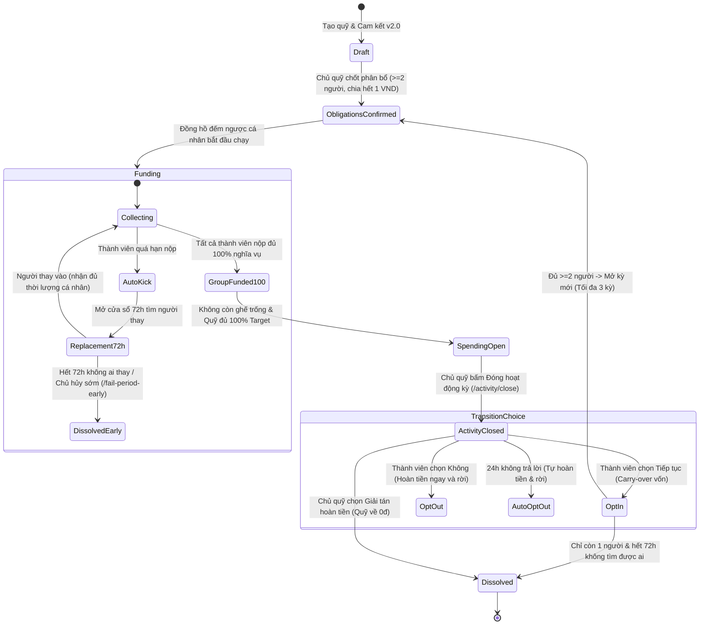
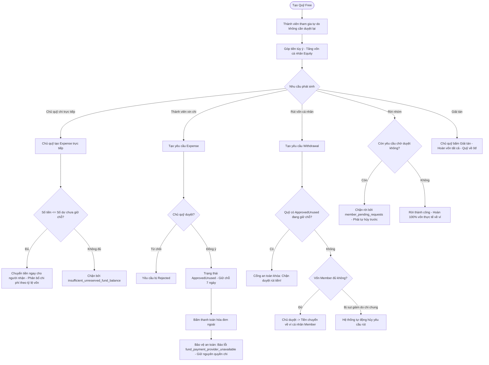
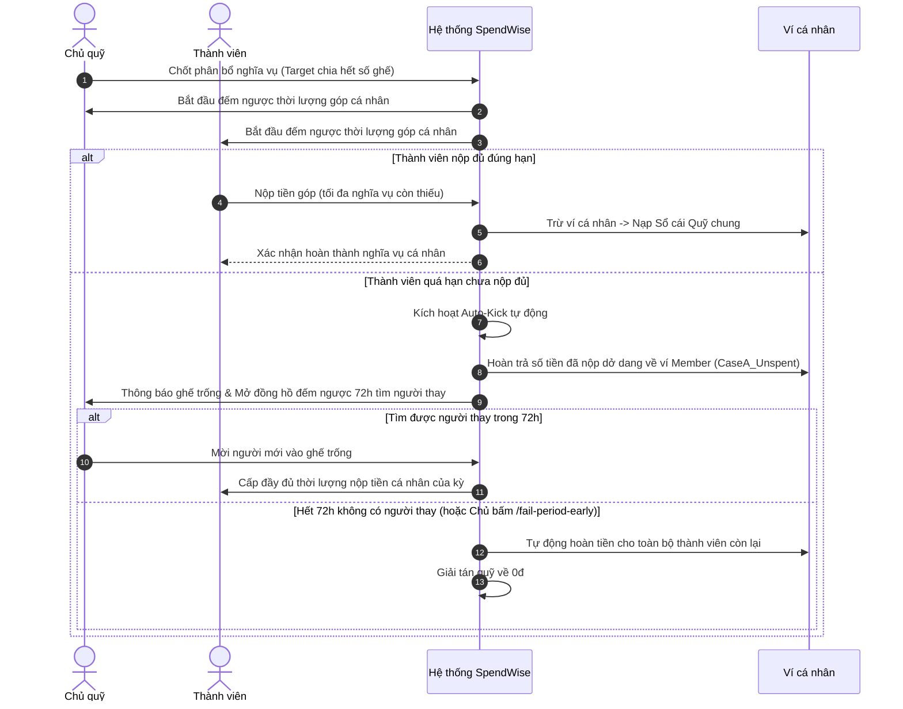
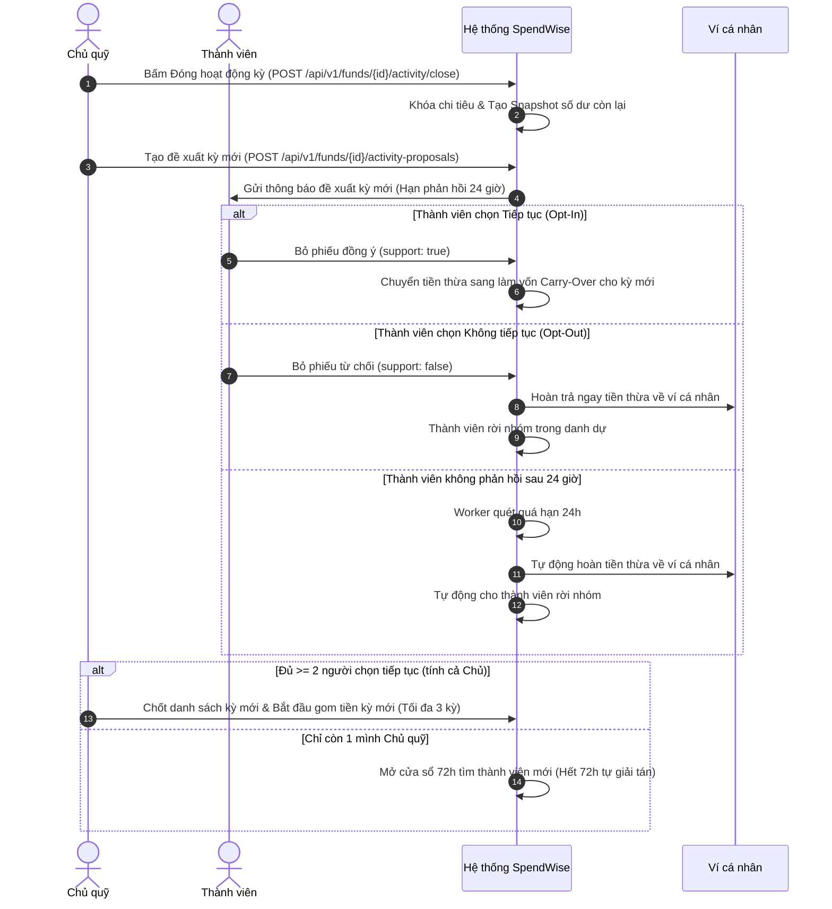
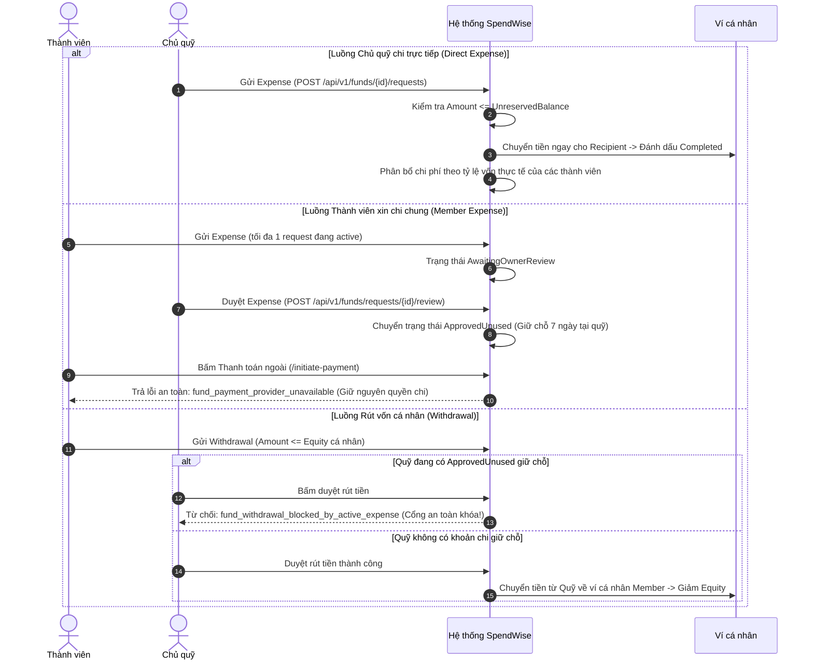
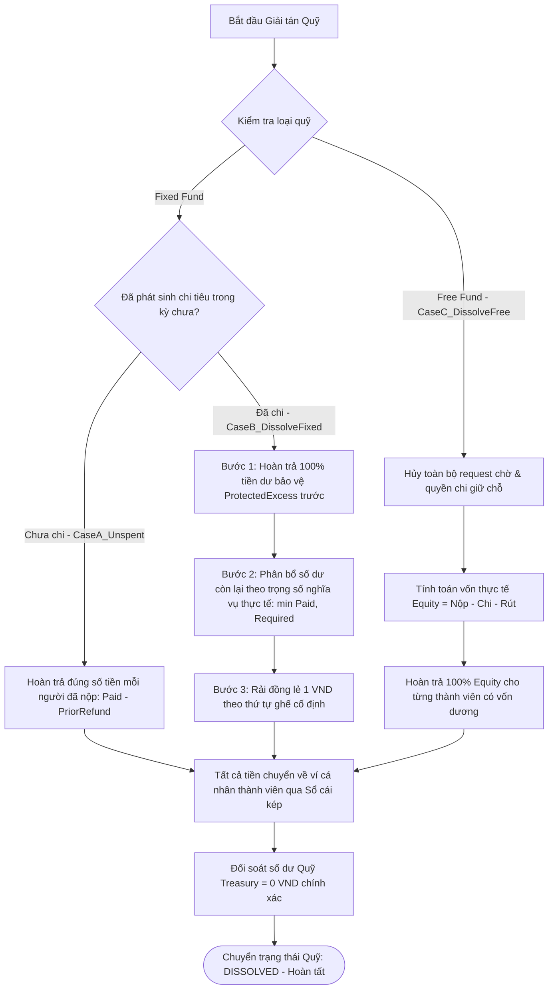

# HƯỚNG DẪN TOÀN DIỆN VỀ QUỸ NHÓM SPENDWISE (GROUP FUNDS V1.0)
## DÀNH CHO NGƯỜI DÙNG, THIẾT KẾ GIAO DIỆN VÀ LẬP TRÌNH FRONTEND

> **Phiên bản:** V1.0 — Chuẩn hóa theo Backend ASP.NET Core & SQL Server thực tế trên nhánh `main`.  
> **Áp dụng cho:**
> 1. **Fixed Fund V2** — Quỹ nhóm Cố định (đặc tả theo [`fixed.md`](../fixed.md) và Stage 1–5 đã nghiệm thu).
> 2. **Free Fund V1** — Quỹ nhóm Tự do (đặc tả theo [`User.md`](../User.md) Mục 1.3, 1.3.1 và các API Mục 3.6).
>
> **Mục đích:** Cung cấp tài liệu nghiệp vụ dễ hiểu cho người mới, đồng thời cung cấp hợp đồng giao diện chính xác 100% cho đội ngũ thiết kế (Google AI Studio), lập trình frontend (React/TypeScript) và kiểm thử (QA).

---

## MỤC LỤC

1. [Phần I — Giới thiệu tổng quan](#phần-i--giới-thiệu-tổng-quan)
2. [Phần II — Hướng dẫn Quỹ nhóm Cố định (Fixed Fund V2)](#phần-ii--hướng-dẫn-quỹ-nhóm-cố-định-fixed-fund-v2)
3. [Phần III — Hướng dẫn Quỹ nhóm Tự do (Free Fund V1)](#phần-iii--hướng-dẫn-quỹ-nhóm-tự-do-free-fund-v1)
4. [Phần IV — Bảng tra cứu các tình huống thực tế thường gặp](#phần-iv--bảng-tra-cứu-các-tình-huống-thực-tế-thường-gặp)
5. [Phần V — Sơ đồ luồng hoạt động (6 Sơ đồ Mermaid đầy đủ)](#phần-v--sơ-đồ-luồng-hoạt-động-mermaid-workflow)
6. [Phần VI — Hướng dẫn kỹ thuật dành cho Frontend & AI Studio](#phần-vi--hướng-dẫn-kỹ-thuật-dành-cho-frontend--ai-studio)

---

# PHẦN I — GIỚI THIỆU TỔNG QUAN

### 1. Quỹ nhóm SpendWise là gì?
Trong cuộc sống hàng ngày, chúng ta thường xuyên phát sinh nhu cầu gom tiền và chi tiêu chung:
- **Tiền phòng trọ, điện nước:** Hàng tháng mỗi người phải đóng đúng 3.000.000đ trước ngày 05, chủ phòng thu đủ thì thanh toán cho chủ nhà.
- **Chuyến du lịch nhóm:** 4 người bạn đi Đà Lạt, mỗi người nộp 2.000.000đ để đặt cọc vé xe và khách sạn; nếu thừa tiền thì chia đều trả lại.
- **Quỹ ăn trưa đồng nghiệp:** Ai thích thì nộp bao nhiêu tùy ý, hôm nay ăn bún bò hết 150.000đ thì quỹ tự trừ đều theo tỷ lệ tiền của từng người.

**SpendWise Group Funds** là tính năng ngân hàng số thu nhỏ trong ứng dụng SpendWise, giúp một nhóm người cùng quản lý tiền minh bạch, công bằng, tự động hóa tính toán và bảo vệ quyền lợi tài chính cho từng thành viên.

---

### 2. Thuật ngữ căn bản (Giải thích trước khi đọc)

| Thuật ngữ | Tiếng Anh trong hệ thống | Ý nghĩa thực tế |
|:---|:---|:---|
| **Chủ quỹ** | `Owner` | Người tạo nhóm hoặc người được bầu làm chủ nhóm. Chịu trách nhiệm chốt mục tiêu, phê duyệt thành viên và đóng/giải tán quỹ. |
| **Thành viên** | `Member` | Người tham gia vào quỹ để cùng đóng góp hoặc chi tiêu. |
| **Mục tiêu quỹ** | `TargetVnd` | Tổng số tiền mà cả nhóm cần gom lại cho kỳ hoạt động (chỉ có ở Quỹ Cố định). |
| **Nghĩa vụ đóng góp** | `Obligation` | Số tiền cố định mà mỗi người bắt buộc phải nộp trong kỳ (bằng Tổng mục tiêu chia đều cho số ghế). |
| **Thời lượng nộp tiền** | `ContributionDurationHours` | Khoảng thời gian (tính bằng giờ) mà hệ thống cho phép mỗi người nộp tiền, tính từ lúc chốt danh sách. Giới hạn validation backend từ **1 đến 720 giờ** (mặc định 24 giờ). |
| **Số dư quỹ** | `Treasury Balance` | Tổng số tiền thực tế đang nằm trong tài khoản quỹ chung của nhóm, được bảo chứng bằng sổ cái kép (`LedgerAccount`). |
| **Vốn thực tế** | `Equity` | Phần tiền thực sự thuộc sở hữu của riêng bạn trong quỹ tại một thời điểm (Tổng tiền bạn đã nộp trừ phần bạn đã chi chung và trừ tiền bạn đã rút). |
| **Quyền chi đã duyệt** | `ApprovedUnused` | Khoản tiền Chủ quỹ đã đồng ý cho Thành viên chi, nhưng tiền vẫn nằm trong quỹ chứ chưa chuyển về ví cá nhân. Thành viên có **7 ngày** để dùng quyền này. |
| **Vốn chuyển tiếp** | `Carry-over` | Tiền còn dư của bạn từ kỳ hoạt động trước được tự động chuyển sang kỳ hoạt động mới để khấu trừ vào nghĩa vụ đóng góp mới. |
| **Tiền dư bảo vệ** | `ProtectedExcess` | Số tiền bạn đóng dư từ kỳ trước chuyển sang (vượt quá nghĩa vụ kỳ mới). Số tiền này bị khóa, nhóm **không được phép chi tiêu**, và sẽ được hoàn lại nguyên vẹn khi bạn rời nhóm hoặc giải tán. |
| **Tự động loại** | `Auto-Kick` | Nếu hết hạn nộp tiền cá nhân mà thành viên chưa nộp đủ, hệ thống tự động loại thành viên đó ra khỏi nhóm và hoàn lại số tiền họ đã nộp dở dang về ví cá nhân. |
| **Cửa sổ thay thế 72 giờ** | `Replacement Window` | Khoảng thời gian đúng 72 giờ tính từ lần Auto-Kick đầu tiên để Chủ quỹ tìm người mới bù vào ghế trống. |
| **Lượt tham gia** | `Membership Episode` | Mỗi lần một người vào nhóm là một lượt tham gia độc lập, bắt đầu với vốn 0đ, không kế thừa nợ nần hay quyền lợi của lượt tham gia trước. |

---

### 3. Tiền trong quỹ được quản lý như thế nào?
- **Không có tiền mặt hay số dư ảo:** Mọi khoản tiền trong SpendWise đều được ghi nhận bằng **Sổ cái kép (Double-Entry Ledger)**. Khi bạn nộp tiền, tiền chuyển từ Ví cá nhân của bạn vào Tài khoản Quỹ chung (`Treasury`). Khi hoàn tiền, tiền chuyển ngược từ Quỹ chung về Ví cá nhân.
- **Tính toán đến từng 1 VND:** Không làm tròn bừa bãi. Mọi số tiền phân bổ hoặc hoàn trả đều sử dụng thuật toán làm tròn số dư lớn nhất (Largest-Remainder Method), đảm bảo tổng tiền trả lại cho từng người cộng lại khớp đúng 100% từng đồng với số dư tài khoản quỹ.

---

### 4. Bảng so sánh nhanh hai loại quỹ: Quỹ Cố định vs Quỹ Tự do

| Tiêu chí | Quỹ Cố định (Fixed Fund V2) | Quỹ Tự do (Free Fund V1) |
|:---|:---|:---|
| **Mục đích phù hợp** | Đi du lịch, tiền phòng trọ, mua sắm đồ dùng chung có kế hoạch rõ ràng. | Quỹ ăn uống sinh hoạt hàng ngày, quỹ văn phòng, nhóm bạn uống cà phê. |
| **Số thành viên tối đa** | Tối đa **30 người**. | Tối đa **6 người**. |
| **Mục tiêu gom tiền (`Target`)** | **Bắt buộc có**, chia đều cho từng ghế chính xác đến 1 VND. | **Không có mục tiêu**, không ràng buộc số tiền. |
| **Hạn nộp tiền (`Deadline`)** | **Bắt buộc có** (từ 1 đến 720 giờ, mặc định 24h). Quá hạn tự động bị Kick. | **Không có hạn nộp**, ai thích nộp lúc nào thì nộp. |
| **Cam kết tin tưởng** | **Bắt buộc xác nhận hộp cam kết** ("Bạn có tin tưởng nhóm này không?"). | Không yêu cầu cam kết. |
| **Ai được chi tiền?** | Người được cấp quyền `CanSpend` (Chủ quỹ mặc định có, Thành viên phải được Chủ cấp). | - **Chủ quỹ:** Chi trực tiếp từ số dư chưa giữ chỗ.<br>- **Thành viên:** Gửi yêu cầu chi chung chờ Chủ duyệt. |
| **Điều kiện được chi tiền** | Quỹ phải gom đủ **100% mục tiêu** và **không có ghế trống**. | Quỹ có số dư khả dụng (chưa bị giữ chỗ bởi các quyền chi khác). |
| **Có được rút vốn cá nhân?** | **Không được rút dở dang** trong kỳ. Chỉ nhận hoàn tiền khi kết thúc kỳ hoặc giải tán. | **Được quyền gửi yêu cầu rút vốn** (`Withdrawal`) bất kỳ lúc nào nếu vốn còn đủ. |
| **Duyệt chi chung (`Expense`)** | Chi trực tiếp thanh toán ngay (không có trạng thái chờ duyệt). | Chủ duyệt thì cấp quyền giữ chỗ `ApprovedUnused` trong 7 ngày, chưa chuyển tiền về ví. |
| **Cổng an toàn rút tiền** | Không áp dụng (do không có rút vốn cá nhân). | **Khóa tuyệt đối:** Không cho ai rút vốn khi quỹ đang còn bất kỳ quyền chi nào chưa thanh toán. |
| **Tự rời nhóm (`Leave`)** | **Cấm tự ý rời nhóm** khi kỳ đang hoạt động. | **Được tự do rời nhóm bất kỳ lúc nào**, với điều kiện phải tự hủy hoặc giải quyết hết các yêu cầu đang chờ duyệt. |
| **Chuyển tiếp kỳ mới** | **Có chuyển kỳ** (tối đa 3 kỳ). Bỏ luật đa số: ai đồng ý thì sang kỳ 2, ai không thì nhận tiền về ví và rời nhóm. | Không có khái niệm kỳ. Quỹ hoạt động liên tục cho đến khi giải tán. |
| **Bầu Owner mới** | **Có bầu cử** nếu Owner vắng mặt 15 ngày (2 vòng: 12h bầu phiếu + 12h xác nhận PIN). | **Không có bầu cử**. Owner muốn rời thì bắt buộc phải giải tán quỹ. |
| **Số kỳ tối đa** | Tối đa **3 kỳ hoạt động**. Hết kỳ 3 bắt buộc giải tán. | Hoạt động liên tục, không giới hạn kỳ. |

---

# PHẦN II — HƯỚNG DẪN QUỸ NHÓM CỐ ĐỊNH (FIXED FUND V2)

### 1. Tạo quỹ
- **Ai được tạo:** Bất kỳ người dùng nào có tài khoản SpendWise đang hoạt động, có mã PIN bảo mật và tài khoản ngân hàng liên kết.
- **Thông tin cần nhập khi tạo:**
  1. *Tên quỹ:* Tối đa **160 ký tự** (ví dụ: "Chuyến đi cắm trại Ba Vì").
  2. *Mục tiêu tiền chung (Target):* Phải là số nguyên dương VND (ví dụ: 9.000.000 VND).
  3. *Thời lượng nộp tiền cá nhân:* Chọn số giờ cho mỗi thành viên nộp tiền (từ **1 đến 720 giờ**, mặc định là 24 giờ).
  4. *Cam kết tin tưởng:* Phải tích chọn đồng ý với hộp cam kết: *"Tôi hiểu đây là quỹ chung có nghĩa vụ đóng góp cố định..."* với phiên bản cam kết `v2.0`. Nếu không đồng ý, hệ thống chặn bằng lỗi `trust_commitment_required`.
  5. *Mã PIN bảo mật:* Nhập 6 số PIN cá nhân để ký quỹ.
- **Trạng thái ngay sau khi tạo:**
  - Quỹ hiển thị số tiền là **0đ / 9.000.000đ**.
  - **Đồng hồ đếm ngược CHƯA CHẠY** vì Chủ quỹ chưa chốt danh sách thành viên.

---

### 2. Mời thành viên tham gia
- **Chủ quỹ mời:** Chủ quỹ có thể gửi lời mời trực tiếp đến bất kỳ ai đã kết bạn trên SpendWise (yêu cầu người được mời chưa tham gia quá 10 nhóm).
- **Thành viên mời:** Thành viên trong nhóm có thể đề xuất mời một người bạn. Lời mời này xuất hiện dưới dạng đề xuất (`Invitation Proposal`) và **bắt buộc Chủ quỹ phải bấm Duyệt** thì người kia mới nhận được lời mời.
- **Hộp cam kết khi nhận lời mời:** Người được mời khi bấm vào lời mời sẽ thấy hộp thoại cảnh báo:
  > **Bạn có tin tưởng nhóm này không?**  
  > *"Đây là quỹ chung có nghĩa vụ đóng góp và thời hạn đã thống nhất. Trong kỳ đang hoạt động, bạn không được tự ý rời nhóm hoặc đòi rút vốn. Mọi khoản chi tiêu đều được đối soát minh bạch..."*  
  - Nếu bấm **[Không tin tưởng / Từ chối]**: Lời mời bị hủy, bạn không bị ảnh hưởng gì.  
  - Nếu bấm **[Tin tưởng, tiếp tục]**: Bạn chính thức nhận một ghế trong nhóm.

---

### 3. Chốt nghĩa vụ đóng góp (Bắt đầu kỳ)
Trước khi gom tiền, Chủ quỹ phải thực hiện bước **Chốt nghĩa vụ**:
1. **Điều kiện chốt:** Nhóm phải có **ít nhất 2 thành viên** (tính cả Chủ quỹ).
2. **Quy tắc chia tiền bắt buộc:** Tổng mục tiêu phải **chia hết chính xác cho số thành viên đến từng 1 VND**.
   - *Ví dụ hợp lệ:* Mục tiêu 9.000.000đ chia cho 3 người = 3.000.000đ/người. Chốt thành công!
   - *Ví dụ bị từ chối:* Mục tiêu 10.000.000đ chia cho 3 người = 3.333.333,33đ. Hệ thống **từ chối chốt ngay lập tức** và báo lỗi `target_not_divisible_by_seats`. Chủ quỹ phải đổi mục tiêu thành 9.999.999đ hoặc 10.000.002đ hoặc thay đổi số người.
3. **Điều gì xảy ra sau khi bấm Chốt:**
   - Hệ thống tạo một **Bản chụp bất biến (Snapshot)**: Khóa cứng mục tiêu, danh sách ghế, số tiền mỗi ghế phải nộp.
   - **Tuyệt đối không được sửa mục tiêu hoặc thời hạn giữa kỳ.**
   - Đồng hồ đếm ngược bắt đầu chạy riêng cho từng người: `Hạn chót = Thời điểm chốt + Thời lượng nộp tiền`.

---

### 4. Góp tiền vào quỹ
- **Số tiền cần nộp:** Đúng bằng phần nghĩa vụ của ghế (ví dụ: 3.000.000đ).
- **Cách nộp:** Có thể nộp một lần đủ luôn hoặc nộp làm nhiều lần (ví dụ nộp 1.000.000đ trước, hôm sau nộp tiếp 2.000.000đ). Hệ thống chỉ cho phép nộp tối đa bằng phần nghĩa vụ còn thiếu.
- **Tiền đi về đâu:** Trừ từ Ví chính của bạn và chuyển thẳng vào Sổ cái Quỹ chung.
- **Quy tắc quan trọng:** Cho dù đã gom được 8.990.000đ / 9.000.000đ, chỉ cần thiếu 10.000đ thì **toàn bộ quỹ vẫn bị khóa chi tiêu**. Phải đủ 100% mục tiêu mới được mở chi.

---

### 5. Auto-Kick và Quy trình tìm người thay thế trong 72 giờ
Nếu đến hạn chót cá nhân mà thành viên chưa nộp đủ tiền:

1. **Thành viên bị Auto-Kick:**
   - Hệ thống tự động đẩy thành viên ra khỏi nhóm.
   - Nếu người đó đã nộp dở dang (ví dụ nghĩa vụ 3M mà mới nộp 1M), hệ thống **hoàn trả đúng 1.000.000đ về ví cá nhân** của họ.
   - Ghế bị trống, nhưng **nghĩa vụ 3.000.000đ của ghế đó được giữ nguyên vẹn**. Các thành viên đã nộp đủ tuyệt đối không phải nộp bù cho người bị kick!
2. **Cửa sổ 72 giờ duy nhất:**
   - Kể từ thời điểm lần Auto-Kick đầu tiên xảy ra, hệ thống mở một chiếc đồng hồ đếm ngược đúng **72 giờ** cho cả nhóm để tìm người mới.
   - Các lần kick sau (nếu có) **không đặt lại đồng hồ 72 giờ này**.
3. **Người vào thay thế (Replacement Member):**
   - Người mới nhận chiếc ghế trống với đúng nghĩa vụ của ghế đó (ví dụ: 3.000.000đ).
   - **Đặc quyền thời gian:** Cho dù người thay thế chấp nhận lời mời vào phút thứ 71 của cửa sổ 72 giờ, họ vẫn được hưởng **trọn vẹn thời lượng nộp tiền cá nhân** (ví dụ đủ 24 giờ nữa để nộp tiền).
4. **Nếu hết 72 giờ mà không tìm được người:**
   - Kỳ gom tiền chính thức thất bại. Hệ thống tự động hoàn lại toàn bộ số tiền đã nộp của các thành viên còn lại về ví của họ và **tự động giải tán nhóm**.
5. **Quyền kết thúc sớm của Chủ quỹ:**
   - Nếu sau khi một người bị kick, Chủ quỹ thấy không thể tìm được ai thay thế, Chủ quỹ có quyền bấm nút **"Kết thúc kỳ sớm"** (`/fail-period-early`) để hoàn tiền ngay lập tức cho mọi người mà không cần phải chờ hết 72 giờ.
6. **Nếu chính Chủ quỹ không nộp đủ tiền trước hạn:**
   - Hệ thống không kick Chủ quỹ, nhưng kỳ gom tiền **thất bại ngay lập tức**. Toàn bộ thành viên được tự động hoàn tiền 100% và nhóm giải tán, không yêu cầu Chủ quỹ phải đăng nhập hay nhập PIN.

---

### 6. Chi tiêu trong quỹ
Sau khi quỹ gom đủ 100% mục tiêu và không còn ghế trống nào, trạng thái chi tiêu chuyển sang **MỞ (`OPEN`)**:
- **Quyền chi `CanSpend`:**
  - Chủ quỹ có quyền chi mặc định.
  - Chủ quỹ có thể bật hoặc tắt quyền `CanSpend` cho bất kỳ thành viên nào (với điều kiện thành viên đó đã nộp đủ 100% nghĩa vụ).
- **Thực hiện chi tiêu:**
  - Người có quyền `CanSpend` thực hiện giao dịch chi tiêu trực tiếp qua ứng dụng.
  - Bắt buộc phải có: **Người nhận tiền** (UserId hợp lệ trong hệ thống) + **Lý do chi** + **Mã PIN cá nhân**.
  - Tiền được trừ trực tiếp từ Quỹ chung chuyển thẳng đến ví người nhận, **không tạo yêu cầu chờ duyệt**.
- **Khóa tiền dư bảo vệ (`ProtectedExcess`):**
  - Nếu trong quỹ có khoản tiền dư từ kỳ trước chuyển sang (Carry-over excess), số tiền này bị hệ thống khóa lại. Người chi chỉ được chi trong phạm vi số tiền của kỳ hiện tại, tuyệt đối không được chạm vào tiền dư bảo vệ của người khác.

---

### 7. Hoàn thành kỳ hoạt động
Khi chuyến đi kết thúc hoặc nhóm đã chi tiêu xong các mục tiêu đề ra:
- Chủ quỹ bấm nút **"Đóng hoạt động kỳ"** (`POST /api/v1/funds/{id}/activity/close`).
- Hệ thống chốt số dư còn lại trong quỹ và ghi nhận bản chụp tài chính.
- Từ lúc này, mọi hoạt động chi tiêu bị khóa lại. Chủ quỹ có 2 lựa chọn:
  1. *Giải tán nhóm và hoàn lại tiền thừa cho mọi người.*
  2. *Đề xuất mở một kỳ hoạt động mới.*

---

### 8. Chuyển sang kỳ tiếp theo (Tối đa 3 kỳ)
Khác với mô hình cũ yêu cầu biểu quyết đa số > 50%, Fixed Fund V2 áp dụng nguyên tắc **Tôn trọng lựa chọn cá nhân**:
- Chủ quỹ tạo đề xuất kỳ mới với tên và mục tiêu mới.
- Mỗi thành viên nhận được thông báo với 2 nút lựa chọn độc lập:
  - **[Tiếp tục tham gia kỳ mới]:** Tiền thừa của bạn ở kỳ cũ sẽ được chuyển sang làm vốn ban đầu (`Carry-over`) cho kỳ mới. Nếu tiền thừa nhiều hơn nghĩa vụ kỳ mới, phần thừa trở thành `ProtectedExcess`.
  - **[Không tiếp tục]:** Bạn được **hoàn trả tiền thừa ngay lập tức về ví cá nhân** và rời khỏi nhóm trong danh dự, không phải chờ ai duyệt.
  - **Không phản hồi sau 24 giờ:** Nếu sau 24 giờ bạn không bấm nút nào, hệ thống tự động coi như bạn chọn "Không", hoàn tiền về ví và cho bạn rời nhóm.
- **Điều kiện mở kỳ mới:** Phải có **ít nhất 2 người chọn Tiếp tục** (tính cả Chủ quỹ). Nếu chỉ có 1 mình Chủ quỹ, hệ thống mở cửa sổ 72 giờ để Chủ quỹ mời thành viên mới, quá 72 giờ không có ai thì tự giải tán.
- **Giới hạn 3 kỳ:** Một nhóm chỉ được hoạt động tối đa 3 kỳ. Khi kết thúc kỳ 3, hệ thống **bắt buộc giải tán và hoàn tiền**, không cho phép tạo kỳ thứ 4 (chặn bởi `maximum_periods_exceeded`).

---

### 9. Bầu Chủ quỹ mới (Khi Chủ quỹ vắng mặt)
Nếu Chủ quỹ bỏ bê nhóm, đi vắng không hoạt động trong **15 ngày liên tục** (có chứng cứ đăng nhập hệ thống):
- Bất kỳ thành viên nào cũng có quyền bấm nút **"Mở cuộc bầu cử Chủ quỹ mới"**.
- Cuộc bầu cử diễn ra theo quy trình 2 vòng nghiêm ngặt:
  - **Vòng 1 (Bỏ phiếu trong 12 giờ):** Các thành viên bỏ phiếu chọn người làm Chủ quỹ mới. Chủ quỹ cũ bị cấm bỏ phiếu. Người nhận được nhiều phiếu nhất sẽ chiến thắng. Nếu hòa phiếu hoặc toàn phiếu trắng, cuộc bầu cử thất bại.
  - **Vòng 2 (Xác nhận quyền trong 12 giờ):** Người chiến thắng có 12 giờ để nhập mã PIN chấp nhận nhận chức Chủ quỹ. Nếu từ chối hoặc quá hạn không xác nhận, cuộc bầu cử thất bại.
- **Hậu quả nếu bầu cử thất bại:** Hệ thống mở cửa sổ 24 giờ cho các thành viên tự rời nhóm nhận hoàn tiền; hết 24 giờ hệ thống tự động giải tán toàn bộ quỹ về 0đ.
- **Bảo mật thông tin:** Chủ quỹ mới được bầu chỉ quản lý từ kỳ hiện tại, **tuyệt đối không được xem lịch sử riêng tư và giao dịch của Chủ quỹ cũ ở các kỳ trước**.

---

### 10. Hoàn tiền và Giải tán nhóm (Quy tắc tính toán chính xác)
Hoàn tiền trong Quỹ Cố định **không mặc định chia đều** mà tuân thủ các nguyên tắc phân bổ tài chính sau:
1. **Trường hợp chưa phát sinh chi tiêu (`CaseA_Unspent`):**
   - Mỗi người nhận lại đúng số tiền mình đã nộp dở dang trừ đi các khoản đã nhận trước đó: $\text{Refund}_i = \text{Paid}_i - \text{PriorRefund}_i$.
2. **Trường hợp đã có chi tiêu chung (`CaseB_FixedSpentClearShare` / `CaseB_DissolveFixed`):**
   - **Bảo toàn 100% tiền dư bảo vệ:** Khoản tiền dư do chuyển tiếp từ kỳ trước chưa dùng đến ($\text{ProtectedExcess}_i = \max(0, \text{LockedExcess}_i - \text{PriorRefund}_i)$) được hoàn trả nguyên vẹn cho chủ sở hữu trước.
   - **Phân bổ số dư còn lại:** Sau khi trừ tiền dư bảo vệ, số tiền còn lại trong quỹ được phân bổ cho các thành viên theo trọng số nghĩa vụ thực tế đã đóng $w_i = \min(\text{Paid}_i, \text{Required}_i)$.
   - **Rải đồng lẻ (Odd-cent):** Phần số dư lẻ không chia hết được rải đều 1 VND theo thứ tự ghế cố định (Deterministic seat order).
3. **Giải tán hoàn tất:** Sau khi hoàn tiền cho tất cả mọi người, tài khoản quỹ chung đưa về đúng **0 VND**, nhóm chuyển sang trạng thái đã giải tán (`DISSOLVED`).

---

### 11. Câu chuyện ví dụ vòng đời Fixed Fund V2 hoàn chỉnh

> **Tình huống:** An, Bình, Cường lập nhóm đi cắm trại Ba Vì.
> 1. **Khởi tạo:** An tạo quỹ *"Cắm trại Ba Vì"*, đặt mục tiêu `9.000.000đ`, thời lượng nộp tiền `24 giờ`, xác nhận cam kết tin tưởng v2.0. Quỹ hiển thị 0đ/9.000.000đ, đồng hồ chưa chạy.
> 2. **Gia nhập:** An mời Bình và Cường. Cả hai mở app, đọc cam kết tin tưởng và bấm [Đồng ý]. Nhóm đủ 3 người.
> 3. **Chốt nghĩa vụ:** An bấm "Chốt phân bổ". Hệ thống kiểm tra 9.000.000 / 3 = 3.000.000đ/người (chia hết). Chốt thành công! Snapshot khóa cứng: mỗi người có đúng 24 giờ để nộp 3.000.000đ.
> 4. **Góp tiền & Sự cố:**
>    - An nộp đủ 3.000.000đ ngay.
>    - Bình nộp đủ 3.000.000đ sau vài tiếng.
>    - Cường chỉ nộp 1.000.000đ rồi quên nộp tiếp.
> 5. **Auto-Kick:** Hết 24 giờ, Cường mới nộp 1.000.000đ / 3.000.000đ. Hệ thống tự động kick Cường, hoàn trả ngay 1.000.000đ về ví cá nhân của Cường (`CaseA_Unspent`). Ghế của Cường bị trống với nghĩa vụ giữ nguyên là 3.000.000đ. Hệ thống mở đồng hồ đếm ngược 72 giờ cho cả nhóm.
> 6. **Thay thế thành viên:** An mời Dũng vào thay ghế của Cường. Dũng bấm đồng ý. Dũng được cấp đủ 24 giờ riêng để nộp 3.000.000đ. Dũng nộp đủ 3.000.000đ trong ngày.
> 7. **Mở chi tiêu:** Quỹ đạt đủ 9.000.000đ / 9.000.000đ và không còn ghế trống. Hệ thống mở khóa chi tiêu!
> 8. **Chi tiêu:** An bật quyền `CanSpend` cho Bình. Bình dùng app chuyển 6.000.000đ thanh toán tiền thuê lều trại và đồ nướng cho người bán. Quỹ còn 3.000.000đ.
> 9. **Đóng kỳ:** Chuyến đi kết thúc tốt đẹp, An bấm "Đóng hoạt động kỳ". Quỹ còn dư 3.000.000đ.
> 10. **Chuyển kỳ hoặc Giải tán:** An đề xuất giải tán nhóm. Hệ thống tính toán hoàn trả theo trọng số nghĩa vụ thực tế cho 3 người đang có mặt: An nhận 1.000.000đ, Bình nhận 1.000.000đ, Dũng nhận 1.000.000đ. Số dư quỹ về đúng 0đ. Nhóm giải tán hoàn tất!

---

# PHẦN III — HƯỚNG DẪN QUỸ NHÓM TỰ DO (FREE FUND V1)

### 1. Khái niệm và Khởi tạo quỹ
- **Đặc trưng:** Quỹ Tự do không áp lực mục tiêu, không có hạn nộp tiền. Ai có bao nhiêu nộp bấy nhiêu, khi nào cần chi thì gửi yêu cầu, ai muốn rút tiền hay rời nhóm thì rút tự do.
- **Tạo quỹ:** Nhập tên quỹ (tối đa **160 ký tự**, ví dụ: "Ăn trưa văn phòng"), chọn loại quỹ là `Free`, nhập mã PIN. Không cần nhập mục tiêu tiền, không cần chọn thời hạn nộp, không yêu cầu hộp cam kết.
- **Quy mô:** Tối đa **6 thành viên**.

---

### 2. Mời thành viên
- Cả Chủ quỹ và Thành viên đều có thể gửi lời mời trực tiếp cho bạn bè.
- Người nhận lời mời chỉ cần bấm [Chấp nhận] là vào nhóm ngay, **không cần Chủ quỹ duyệt lại**.

---

### 3. Góp tiền tự do
- Thành viên nộp bất kỳ số tiền nào (ví dụ: 100.000đ, 500.000đ, 2.000.000đ).
- Tiền nộp tăng ngay lập tức vào **Vốn cá nhân (`Equity`)** của bạn trong quỹ và tăng số dư chung của nhóm.

---

### 4. Động cơ tính Vốn Động thời gian thực (Dynamic Equity Engine)
Tại bất kỳ thời điểm nào, vốn của bạn trong quỹ được xác định chính xác theo công thức:
$$\text{Vốn cá nhân (Equity)} = \text{Tổng tiền đã nộp} - \text{Phần chi phí đã gánh} - \text{Tổng tiền đã rút/hoàn}$$

- **Quy tắc thời gian (Epoch-based):** Người nộp sau **tuyệt đối không bị trừ tiền cho các khoản chi đã xảy ra trước thời điểm nộp**.
  - *Ví dụ:* Hôm qua quỹ chi ăn trưa hết 200.000đ (A và B chịu). Hôm nay C mới vào nhóm nộp 500.000đ. C **không bị mất một đồng nào** cho bữa ăn trưa hôm qua. Vốn của C nguyên vẹn 500.000đ.

---

### 5. Yêu cầu Chi chung (`Expense`) & Hai luồng chi tiêu
Hệ thống phân biệt rõ ràng hai luồng chi tiêu trong Quỹ Tự do:

1. **Chủ quỹ chi trực tiếp (Owner Direct Expense):**
   - Chủ quỹ có quyền thực hiện chi tiêu trực tiếp từ số dư khả dụng chưa phân bổ của quỹ (`unreservedBalance = treasuryAccount.Balance - activeReservations`).
   - Tiền chuyển thẳng đến ví người nhận; yêu cầu có trạng thái `Completed` ngay lập tức; số dư quỹ giảm và chi phí phân bổ tức thì theo tỷ lệ vốn của các thành viên.
   - Nếu số tiền chi vượt quá số dư khả dụng chưa phân bổ, hệ thống chặn bằng lỗi `insufficient_unreserved_fund_balance`.
2. **Thành viên tạo yêu cầu chi chung (Member Expense):**
   - Bất kỳ thành viên nào (kể cả người đang có vốn 0đ) đều có quyền tạo yêu cầu chi chung.
   - **Giới hạn 1 yêu cầu:** Mỗi thành viên chỉ được có **tối đa 1 yêu cầu chi chung đang hoạt động** tại một thời điểm (chặn bởi `fund_active_expense_limit_exceeded`).
   - Yêu cầu chuyển đến Chủ quỹ ở trạng thái **Chờ duyệt (`AwaitingOwnerReview`)**.

---

### 6. Chủ quỹ duyệt chi và Trạng thái giữ chỗ 7 ngày (`ApprovedUnused`)
Khi Chủ quỹ duyệt một yêu cầu chi chung của Thành viên:
- **Tiền CHƯA chuyển về ví của người yêu cầu.**
- Trạng thái yêu cầu chuyển thành **Quyền chi đã duyệt (`ApprovedUnused`)**.
- Hệ thống **tạm giữ chỗ (Hold)** số tiền này trong quỹ trong vòng **7 ngày**:
  - Tiền vẫn nằm trong tài khoản quỹ chung.
  - Hạn mức khả dụng của quỹ bị giảm đi tương ứng để đảm bảo luôn có đủ tiền cho khoản chi này.
  - Nếu sau 7 ngày không dùng, hệ thống tự động quét và hủy quyền chi (`Expired`), giải phóng hạn mức cho quỹ.

---

### 7. Yêu cầu Rút vốn cá nhân (`Withdrawal`)
- Thành viên có quyền xin rút tiền từ phần vốn thực tế của mình về lại Ví chính.
- **Giới hạn 1 yêu cầu:** Tối đa **1 yêu cầu rút vốn đang hoạt động** cho mỗi thành viên (chặn bởi `fund_active_withdrawal_limit_exceeded`).
- Số tiền xin rút không được vượt quá số vốn thực tế (`Equity`) hiện có của người đó (chặn bởi `insufficient_member_equity`).

---

### 8. CỔNG AN TOÀN TUYỆT ĐỐI: Khóa duyệt rút tiền khi có quyền chi giữ chỗ
Đây là quy tắc bảo vệ thanh khoản cốt lõi của SpendWise:
> **Nếu trong quỹ đang có BẤT KỲ khoản chi chung nào ở trạng thái giữ chỗ (`ApprovedUnused`), Chủ quỹ TUYỆT ĐỐI KHÔNG THỂ PHÊ DUYỆT yêu cầu rút vốn cá nhân của bất kỳ ai!**

- **Hành vi hệ thống:** Nếu Chủ quỹ cố bấm duyệt, hệ thống từ chối với lỗi `fund_withdrawal_blocked_by_active_expense`. Yêu cầu rút vốn vẫn nằm ở trạng thái chờ (`AwaitingOwnerReview`). Khi nào khoản chi kia hoàn tất hoặc bị hủy bỏ, Chủ quỹ mới duyệt rút tiền được.

---

### 9. Tự động hủy yêu cầu rút tiền khi vốn bị sụt giảm
Xét tình huống: Bạn đang có 500.000đ vốn. Bạn gửi yêu cầu xin rút 400.000đ (đang chờ duyệt).
- Trong lúc yêu cầu đang chờ, nhóm phát sinh một khoản chi chung thành công và phần bạn phải gánh chịu là 200.000đ.
- Vốn thực tế của bạn lúc này chỉ còn: 500.000đ - 200.000đ = 300.000đ.
- Vì số vốn còn lại (300.000đ) nhỏ hơn số tiền bạn đang xin rút (400.000đ), hệ thống **tự động hủy yêu cầu rút tiền** của bạn và gửi thông báo cho bạn biết để làm lại yêu cầu mới phù hợp với số dư mới.

---

### 10. Thành viên rời nhóm (`Leave`) — Ràng buộc bắt buộc
- **Điều kiện tiên quyết bắt buộc:** Khi bạn còn bất kỳ yêu cầu nào đang ở trạng thái Chờ duyệt (`AwaitingOwnerReview`), **hệ thống TUYỆT ĐỐI CHẶN RỜI NHÓM** bằng mã lỗi `member_pending_requests` (*"Thành viên phải tự hủy hoặc chờ giải quyết các yêu cầu đang chờ duyệt trước khi rời quỹ"*).
- **Hệ thống KHÔNG tự động hủy các yêu cầu pending:** Bạn phải chủ động bấm Hủy yêu cầu của chính mình trước khi bấm Rời nhóm.
- **Xử lý quyền chi đã duyệt (`ApprovedUnused`):** Sau khi đã hủy hết pending review, nếu bạn còn quyền chi `ApprovedUnused` của chính mình, khi rời nhóm hệ thống sẽ tự động hủy quyền chi đó.
- **Hoàn tiền 100% vốn thực tế:** Hệ thống tính toán chính xác phần vốn thực tế còn lại và hoàn tiền ngay về Ví cá nhân.
- **Quy tắc giải phóng thanh khoản (Hủy quyền chi mới nhất trước):** Nếu việc bạn rút tiền làm quỹ không còn đủ bảo chứng cho các khoản `ApprovedUnused` của người khác, hệ thống tự động hủy các quyền chi **mới nhất trước**.
- **Cấm Chủ quỹ tự ý rời nhóm:** Chủ nhóm không được bấm Leave (chặn bởi `owner_cannot_leave_free_fund`). Chủ nhóm muốn nghỉ thì bắt buộc phải giải tán quỹ.

---

### 11. Chủ quỹ loại thành viên (`Kick`)
- Chủ quỹ có quyền loại một thành viên ra khỏi nhóm (nếu người đó không còn pending request, nếu còn pending thì cũng bị chặn bởi `member_pending_requests`).
- Khi bị kick, thành viên đó được **hoàn trả đúng 100% phần vốn thực tế hiện tại về ví cá nhân**. Mọi quyền chi chưa dùng của người bị kick tự động bị hủy.

---

### 12. Giải tán Quỹ Tự do (`Dissolve`)
- Chỉ có Chủ quỹ mới có quyền giải tán quỹ.
- Khi giải tán: Hệ thống tự động hủy toàn bộ các yêu cầu đang chờ duyệt và quyền chi giữ chỗ; tính toán phần vốn thực tế của tất cả các thành viên còn lại; chuyển trả tiền sòng phẳng về ví của từng người; đưa số dư quỹ về đúng **0 VND**.

---

### 13. Phân bổ chi chung và Làm tròn số lẻ (Ví dụ số học thực tế)

| Trường hợp | Diễn biến | Kết quả tài chính chính xác |
|:---:|:---|:---|
| **Ví dụ 1** | An góp 600.000đ, Bình góp 400.000đ (tỷ lệ 60% / 40%). Cả nhóm chi ăn trưa hết 200.000đ. | An chịu 60% = 120.000đ (còn 480.000đ).<br>Bình chịu 40% = 80.000đ (còn 320.000đ).<br>Quỹ còn đúng 800.000đ. |
| **Ví dụ 2** | Bình quyết định rời nhóm ngay sau bữa ăn trên (Bình không còn pending request). | Bình nhận hoàn lại đúng phần vốn: **320.000đ** về ví.<br>An vẫn còn nguyên 480.000đ trong quỹ. |
| **Ví dụ 3** | Cường vào nhóm sau khoản chi trên, nộp 200.000đ rồi xin rời ngay. | Cường không chịu khoản chi 200k cũ. Rời nhận đủ **200.000đ**.<br>An vẫn còn nguyên 480.000đ. |
| **Ví dụ 4** | An có 1.000.000đ, Bình có 0đ. Chi chung hết 200.000đ. | An chịu toàn bộ 200.000đ (An còn 800.000đ).<br>Bình chịu 0đ (Bình vẫn 0đ). |
| **Ví dụ 5** | Chia đồng lẻ: 3 người cùng vốn chi chung 100.000đ. | 100.000đ chia 3 = 33.333,33đ. Rải 1đ cho người đầu:<br>Người 1 chịu **33.334đ**, Người 2 chịu **33.333đ**, Người 3 chịu **33.333đ**.<br>Tổng cộng khớp đúng 100.000đ. |

---

### 14. Trường hợp Thanh toán bên ngoài (`External Payment Provider`)
- **Hiện trạng kỹ thuật:** Trong phiên bản V1.0, SpendWise tập trung hoàn thiện hạch toán sổ cái nội bộ. Cổng tích hợp thanh toán hóa đơn bên ngoài với các nhà cung cấp dịch vụ (điện, nước, vé máy bay...) là module mở rộng đang chờ kết nối đối tác.
- **Hành vi thực tế khi bấm "Thanh toán bằng quyền chi" (`/initiate-payment`):**
  - Hệ thống kiểm tra hợp lệ và trả về mã lỗi an toàn: `fund_payment_provider_unavailable` (*"Cổng thanh toán hóa đơn đối ngoại chưa sẵn sàng. Quyền chi vẫn được giữ ở trạng thái ApprovedUnused"*).
  - Quyền chi của bạn **vẫn được bảo toàn nguyên vẹn**, không bị mất tiền và không bị trừ số dư dở dang.

---

### 15. Câu chuyện ví dụ vòng đời Free Fund V1 hoàn chỉnh

> **Tình huống:** An (Chủ quỹ), Bình và Chi lập quỹ ăn trưa và uống cà phê chung tại công ty.
> 1. **Khởi tạo:** An tạo quỹ *"Ăn trưa & Cà phê"*, chọn loại `Free`, nhập PIN. Quỹ có số dư ban đầu 0đ.
> 2. **Gia nhập:** An mời Bình và Chi. Cả hai bấm chấp nhận và vào nhóm ngay lập tức (không cần An duyệt lại).
> 3. **Góp tiền tự do:**
>    - An nộp 600.000đ vào quỹ.
>    - Bình nộp 400.000đ vào quỹ.
>    - Chi chưa có lương nên chưa nộp (vốn của Chi là 0đ).
>    - Số dư quỹ lúc này là **1.000.000đ** (An: 600k (60%), Bình: 400k (40%), Chi: 0đ (0%)).
> 4. **Tạo yêu cầu chi chung:** Chi đi ăn cùng nhóm và đứng ra tạo yêu cầu chi chung 200.000đ tiền cơm trưa. Dù Chi đang có vốn 0đ, hệ thống vẫn cho phép Chi tạo yêu cầu gửi An duyệt.
> 5. **Duyệt giữ chỗ 7 ngày:** An duyệt yêu cầu của Chi. Yêu cầu chuyển sang trạng thái `ApprovedUnused` giữ chỗ 200.000đ trong 7 ngày. Tiền vẫn nằm trong quỹ (1.000.000đ), nhưng hạn mức khả dụng của quỹ giảm xuống còn 800.000đ.
> 6. **Cổng an toàn khóa rút tiền:** Bình muốn rút 100.000đ về ví cá nhân nên gửi yêu cầu Withdrawal. Khi An vào duyệt cho Bình, hệ thống **từ chối duyệt** và báo lỗi `fund_withdrawal_blocked_by_active_expense` vì quỹ đang có khoản chi 200k giữ chỗ của Chi chưa xử lý xong. Yêu cầu rút của Bình tiếp tục nằm chờ an toàn.
> 7. **Chủ quỹ chi trực tiếp:** Vì cổng thanh toán ngoài đang bảo trì, An quyết định dùng quyền Chủ quỹ thực hiện khoản chi trực tiếp 200.000đ thanh toán hóa đơn cơm trưa cho chủ quán. Giao dịch thành công ngay lập tức!
>    - Quỹ bị trừ 200.000đ (còn 800.000đ).
>    - Chi phí 200.000đ phân bổ theo tỷ lệ vốn: An chịu 120.000đ (vốn còn 480.000đ), Bình chịu 80.000đ (vốn còn 320.000đ), Chi chịu 0đ.
>    - Khoản `ApprovedUnused` 200k của Chi được An hủy hoặc hoàn tất, giải phóng hạn mức.
> 8. **Mở khóa duyệt rút tiền:** Sau khi không còn khoản chi giữ chỗ nào, An duyệt thành công yêu cầu rút 100.000đ cho Bình. Bình nhận 100.000đ về ví cá nhân. Vốn của Bình còn lại 220.000đ. Quỹ còn 700.000đ.
> 9. **Rời nhóm hợp lệ:** Bình muốn rời nhóm. Bình kiểm tra không còn yêu cầu nào đang chờ duyệt, bấm nút [Rời nhóm] -> Hệ thống hoàn trả ngay **220.000đ** về ví cá nhân của Bình. Bình rời nhóm thành công. Quỹ còn 480.000đ (toàn bộ thuộc sở hữu của An).
> 10. **Giải tán quỹ:** An bấm [Giải tán quỹ]. An nhận lại toàn bộ **480.000đ** về ví của mình. Số dư quỹ về đúng 0đ. Quỹ giải tán hoàn tất!

---

# PHẦN IV — BẢNG TRA CỨU CÁC TÌNH HUỐNG THỰC TẾ THƯỜNG GẶP

| Tình huống của bạn | Loại quỹ áp dụng | Bạn thao tác gì? | Hệ thống phản ứng thế nào? | Kết quả cuối cùng |
|:---|:---:|:---|:---|:---|
| **Tôi muốn lập quỹ để cả nhóm đi du lịch** | **Fixed** | Bấm Tạo quỹ -> Chọn Fixed -> Nhập mục tiêu (ví dụ 10M) -> Chọn thời hạn nộp (1-720h) -> Tích cam kết v2.0 -> Nhập PIN. | Kiểm tra mục tiêu > 0, thời lượng hợp lệ, cam kết v2.0. Tạo quỹ thành công. | Quỹ hiển thị 0đ/10M, đồng hồ chưa chạy. Bạn bắt đầu mời bạn bè. |
| **Tôi muốn gom tiền ăn trưa hàng ngày** | **Free** | Bấm Tạo quỹ -> Chọn Free -> Nhập tên quỹ (tối đa 160 ký tự) -> Nhập PIN. | Tạo quỹ thành công, không đòi hỏi mục tiêu hay thời hạn. | Quỹ sẵn sàng nhận tiền nộp bất kỳ lúc nào. |
| **Tôi muốn nộp thêm tiền** | **Cả hai** | Bấm [Nộp tiền] -> Chọn ví nguồn -> Nhập số tiền -> Nhập PIN. | Fixed: Kiểm tra không vượt nghĩa vụ còn thiếu.<br>Free: Cho phép nộp tự do. | Tiền chuyển từ ví bạn vào quỹ, sổ cái cập nhật ngay lập tức. |
| **Tôi không kịp nộp tiền trước hạn** | **Fixed** | Hết giờ đếm ngược cá nhân mà bạn chưa nộp đủ. | Hệ thống kích hoạt Auto-Kick tự động. | Bạn bị loại khỏi nhóm; số tiền bạn đã nộp dở dang được hoàn về ví cá nhân; nhóm mở 72h tìm người thay. |
| **Tôi muốn rời nhóm nhưng còn yêu cầu chờ duyệt** | **Free** | Bấm [Rời nhóm] khi còn yêu cầu chờ duyệt. | Hệ thống từ chối với lỗi `member_pending_requests`. | Bạn phải bấm Hủy các yêu cầu đang chờ duyệt của mình trước rồi mới được rời nhóm. |
| **Tôi muốn rời nhóm hợp lệ** | **Free** | Hủy hết yêu cầu chờ duyệt -> Bấm [Rời nhóm] -> Nhập PIN. | Tính toán vốn thực tế còn lại; hủy các quyền chi ApprovedUnused của bạn; kiểm tra thanh khoản. | Bạn rời nhóm ngay lập tức; nhận 100% tiền vốn còn lại về ví cá nhân. |
| **Tôi muốn rời nhóm giữa kỳ** | **Fixed** | Bấm [Rời nhóm] khi kỳ đang hoạt động. | Hệ thống từ chối với lỗi `fixed_voluntary_leave_disallowed`. | Bạn không được rời nhóm dở dang; phải đợi kết thúc kỳ hoặc khi có bầu cử thất bại. |
| **Tôi muốn rút tiền của mình về ví** | **Free** | Bấm [Rút vốn] -> Nhập số tiền muốn rút -> Nhập PIN. | Kiểm tra số tiền <= Vốn thực tế; tạo yêu cầu rút vốn gửi Chủ quỹ duyệt. | Yêu cầu chờ duyệt. (Lưu ý: Chủ quỹ không thể duyệt nếu quỹ đang có khoản chi giữ chỗ). |
| **Chủ quỹ muốn chi tiền trong Quỹ Tự do** | **Free** | Chủ quỹ tạo Expense với số tiền <= số dư khả dụng chưa phân bổ -> Nhập PIN. | Trừ trực tiếp tài khoản quỹ chung; chuyển tiền vào ví người nhận; phân bổ chi phí theo tỷ lệ vốn. | Khoản chi hoàn tất ngay lập tức (`Completed`), không cần qua bước giữ chỗ 7 ngày. |
| **Chủ quỹ đi vắng không online 15 ngày** | **Fixed** | Bạn bấm [Mở bầu cử Chủ quỹ mới]. | Kiểm tra bằng chứng đăng nhập của Chủ quỹ >= 15 ngày. | Cuộc bầu cử mở ra trong 12 giờ cho các thành viên bỏ phiếu chọn Chủ mới. |
| **Nhóm kết thúc hoạt động muốn chia tiền** | **Fixed** | Chủ quỹ bấm [Đóng kỳ] -> Bấm [Giải tán nhóm]. | Đối soát sổ cái; bảo vệ 100% tiền dư ProtectedExcess; phân bổ số dư còn lại theo trọng số nghĩa vụ; rải đồng lẻ theo ghế. | Mọi người nhận lại tiền thừa minh bạch; quỹ về 0đ và giải tán hoàn tất. |

---

# PHẦN V — SƠ ĐỒ LUỒNG HOẠT ĐỘNG (6 SƠ ĐỒ MERMAID ĐẦY ĐỦ)

### Sơ đồ 1: Vòng đời tổng thể Quỹ Cố định (Fixed Fund V2 Lifecycle)



---

### Sơ đồ 2: Vòng đời tổng thể Quỹ Tự do (Free Fund V1 Lifecycle)



---

### Sơ đồ 3: Quy trình Góp tiền, Hạn chót & Auto-Kick trong Quỹ Cố định



---

### Sơ đồ 4: Quy trình Đóng kỳ & Chuyển kỳ tiếp theo trong Quỹ Cố định (Fixed Transition)



---

### Sơ đồ 5: Chi tiết Luồng Yêu cầu Chi chung & Rút vốn trong Quỹ Tự do (Free Fund)



---

### Sơ đồ 6: Quy trình Hoàn tiền & Giải tán Quỹ (Refund & Dissolution)



---

# PHẦN VI — HƯỚNG DẪN KỸ THUẬT DÀNH CHO FRONTEND & GOOGLE AI STUDIO

Phần này đặc biệt dành cho các kỹ sư lập trình Frontend (React / React Native / Flutter) và thiết kế giao diện bằng Google AI Studio. **Mọi endpoint, tên trường và mã lỗi dưới đây đều lấy chính xác 100% từ controller C# hiện tại.**

---

### 1. Bảng thiết kế các màn hình chính

#### Màn hình 1: Tạo quỹ mới (`Create Fund Screen`)
- **API thực tế:** `POST /api/v1/funds`
- **Request Body (Quỹ Cố định V2):**
  ```json
  {
    "name": "Chuyến đi cắm trại Ba Vì",
    "kind": "Fixed",
    "targetVnd": 9000000,
    "contributionDurationHours": 24,
    "trustCommitmentAccepted": true,
    "commitmentVersion": "v2.0",
    "securityPin": "123456"
  }
  ```
- **Request Body (Quỹ Tự do V1):**
  ```json
  {
    "name": "Ăn trưa văn phòng",
    "kind": "Free",
    "targetVnd": null,
    "securityPin": "123456"
  }
  ```
- **Điều kiện bật nút [Tạo Quỹ]:**
  - Tên quỹ: không rỗng, từ 1–160 ký tự.
  - Mã PIN: đủ 6 chữ số.
  - Nếu là `Fixed`: `targetVnd` > 0; `contributionDurationHours` từ 1 đến 720 (mặc định hiển thị gợi ý 24h); checkbox Cam kết tin tưởng bắt buộc phải được tích chọn.
  - Nếu là `Free`: Ẩn trường `targetVnd`, ẩn trường `contributionDurationHours`, ẩn checkbox cam kết tin tưởng.
- **Mã lỗi cần xử lý hiển thị:**
  - `invalid_contribution_duration`: "Thời lượng góp phải từ 1 đến 720 giờ (tối đa 30 ngày)."
  - `trust_commitment_required`: "Bạn cần xác nhận cam kết tin tưởng v2.0 để tạo quỹ cố định."
  - `invalid_security_pin`: "Mã PIN bảo mật không chính xác."

---

#### Màn hình 2: Chi tiết Quỹ Cố định & Chốt nghĩa vụ (`Fixed Fund Detail Screen`)
- **API xem thông tin:**
  - Chi tiết quỹ: `GET /api/v1/funds/{id}` → Trả về `V1FundDto` (`targetVnd`, `contributionDurationHours`, `financeAvailability`).
  - Tình trạng tài chính: `GET /api/v1/funds/{id}/finance` → Trả về `V1FinanceDto` (`spendingState`, `balanceVnd`, `obligations`).
  - Xem trước phân bổ: `GET /api/v1/funds/{id}/contribution-allocation` → Hiển thị trước số tiền mỗi người phải nộp.
  - Danh sách thành viên: `GET /api/v1/funds/{id}/members` → Trả về `V1MemberDto[]` (`effectiveCanSpend`, `individualContributionCompleted`, `contributionDeadline`).
- **Nút [Chốt nghĩa vụ đóng góp]:**
  - Chỉ hiển thị với Chủ quỹ (`isOwner == true`).
  - Bật nút khi: Số thành viên >= 2 và chưa từng chốt nghĩa vụ (`configurationCurrent == false` hoặc `revision == 0`).
  - API gọi khi bấm: `POST /api/v1/funds/{id}/obligations/confirm`
  - Body: `{"targetVnd": 9000000, "securityPin": "123456"}`
  - Mã lỗi chặn: `target_not_divisible_by_seats` → Báo lỗi: *"Mục tiêu không chia hết chính xác đến từng 1 VND cho số thành viên. Vui lòng điều chỉnh lại mục tiêu."*

---

#### Màn hình 3: Nộp tiền vào Quỹ (`Contribute Screen`)
- **API thực tế:** `POST /api/v1/funds/{id}/contributions`
- **Request Body:**
  ```json
  {
    "walletId": "3fa85f64-5717-4562-b3fc-2c963f66afa6",
    "amountVnd": 3000000,
    "obligationRevision": 1,
    "purpose": "Nộp tiền kỳ 1",
    "idempotencyKey": "unique-uuid-v4",
    "securityPin": "123456"
  }
  ```
- **Xử lý giao diện:**
  - `amountVnd`: Không cho nhập vượt quá `remainingVnd` hiển thị trong `V1FinanceDto`.
  - `obligationRevision`: Phải lấy đúng giá trị `revision` hiện tại từ `GET /api/v1/funds/{id}/finance`, không tự gõ cứng số 1.
  - `idempotencyKey`: Frontend tự sinh UUID v4 mới cho mỗi lần bấm nộp tiền. Nếu người dùng bấm lại do lỗi mạng, gửi lại đúng key cũ để không bị trừ tiền hai lần.

---

#### Màn hình 4: Quyền chi và Chi tiêu trực tiếp trong Fixed Fund
- **Bật/Tắt quyền chi cho Thành viên (Dành cho Chủ quỹ):**
  - API: `PUT /api/v1/funds/{id}/members/{userId}/spending-permission`
  - Body: `{"enabled": true, "securityPin": "123456"}`
  - Điều kiện hiển thị toggle switch: Chỉ hiện cho Chủ quỹ; toggle chỉ được bật khi thành viên đó đã nộp đủ 100% nghĩa vụ (`individualContributionCompleted == true`).
- **Thực hiện chi tiêu:**
  - API: `POST /api/v1/funds/{id}/requests`
  - Body:
    ```json
    {
      "kind": "Expense",
      "amountVnd": 1500000,
      "recipientUserId": "00000000-0000-0000-0000-000000000002",
      "purpose": "Thanh toán tiền lều trại",
      "idempotencyKey": "unique-uuid-v4",
      "securityPin": "123456"
    }
    ```
  - Điều kiện bật nút [Chi tiền]: Người dùng có `effectiveCanSpend == true` và Quỹ có `spendingState == "OPEN"`.
  - Kết quả trả về: Request có `state: "Completed"` ngay lập tức; số dư quỹ giảm tức thì.

---

#### Màn hình 5: Đóng kỳ, Chuyển kỳ & Bỏ phiếu tiếp tục (`Cycle Transition Screen`)
- **Chủ quỹ đóng kỳ:**
  - API: `POST /api/v1/funds/{id}/activity/close`
  - Body: `{"securityPin": "123456"}`
- **Chủ quỹ tạo đề xuất kỳ mới:**
  - API: `POST /api/v1/funds/{id}/activity-proposals`
  - Body: `{"targetVnd": 6000000, "idempotencyKey": "uuid", "securityPin": "123456"}`
- **Thành viên bỏ phiếu Tiếp tục hay Rời đi:**
  - API: `POST /api/v1/funds/activity-proposals/{proposalId}/vote`
  - Chọn Tiếp tục: Body `{"support": true}`
  - Chọn Không tiếp tục (Nhận hoàn tiền ngay): Body `{"support": false}`
- **Chủ quỹ kết thúc sớm khi có ghế trống:**
  - API: `POST /api/v1/funds/{id}/fail-period-early`
  - Body: `{"securityPin": "123456"}`

---

#### Màn hình 6: Quỹ Tự do — Tạo & Duyệt Yêu cầu Chi/Rút (`Free Fund Requests Screen`)
- **Tạo yêu cầu:**
  - API: `POST /api/v1/funds/{id}/requests`
  - Body Chi chung: `{"kind": "Expense", "amountVnd": 200000, "recipientUserId": "...", "purpose": "Tiền cơm trưa", "idempotencyKey": "uuid", "securityPin": "123456"}`
  - Body Rút vốn: `{"kind": "Withdrawal", "amountVnd": 150000, "recipientUserId": "caller-user-id", "purpose": "Rút vốn", "idempotencyKey": "uuid", "securityPin": "123456"}`
- **Khóa nút tạo yêu cầu:**
  - Nếu thành viên đã có 1 Expense đang chờ duyệt hoặc đang giữ chỗ: **Disable nút Tạo Chi chung** (nếu cố gửi: máy chủ trả `fund_active_expense_limit_exceeded`).
  - Nếu thành viên đã có 1 Withdrawal đang chờ duyệt: **Disable nút Tạo Rút vốn** (nếu cố gửi: máy chủ trả `fund_active_withdrawal_limit_exceeded`).
- **Chủ quỹ duyệt/từ chối yêu cầu:**
  - API: `POST /api/v1/funds/requests/{requestId}/review`
  - Body: `{"approved": true, "reason": "Đồng ý", "securityPin": "123456"}`
  - Xử lý mã lỗi khi duyệt Rút tiền: Nếu gặp `fund_withdrawal_blocked_by_active_expense`, hiển thị thông báo popup: *"Quỹ đang có khoản chi chung giữ chỗ 7 ngày chưa hoàn tất. Bạn chỉ có thể duyệt rút tiền sau khi khoản chi kia đã thanh toán hoặc bị hủy."*
- **Hủy yêu cầu:**
  - API: `POST /api/v1/funds/requests/{requestId}/cancel`
  - Body: `{"securityPin": "123456"}`
- **Bấm thanh toán hóa đơn bằng quyền chi:**
  - API: `POST /api/v1/funds/requests/{requestId}/initiate-payment`
  - Body: `{"securityPin": "123456"}`
  - Trả về mã lỗi an toàn: `fund_payment_provider_unavailable` → Frontend hiển thị banner thông báo: *"Cổng thanh toán hóa đơn đối ngoại đang trong quá trình bảo trì/kết nối. Quyền chi của bạn vẫn được giữ nguyên vẹn trong 7 ngày."*

---

#### Màn hình 7: Rời nhóm, Loại thành viên & Giải tán
- **Xem trước số tiền hoàn:**
  - API: `GET /api/v1/funds/{id}/refund-preview`
  - Trả về: `V1RefundPreviewDto` với số tiền dự kiến thực nhận `eligibleRefundAmountVnd`.
- **Thành viên tự rời nhóm (Leave):**
  - API: `POST /api/v1/funds/{id}/leave`
  - Body: `{"securityPin": "123456", "idempotencyKey": "uuid", "destinationWalletId": null}`
  - Mã lỗi chặn: `member_pending_requests` → Báo lỗi: *"Thành viên phải tự hủy hoặc chờ giải quyết các yêu cầu đang chờ duyệt trước khi rời quỹ."*
- **Chủ quỹ loại thành viên (Kick):**
  - API: `POST /api/v1/funds/{id}/members/{userId}/kick`
  - Body: `{"securityPin": "123456", "reason": "Vi phạm nội quy", "idempotencyKey": "uuid", "destinationWalletId": null}`
- **Chủ quỹ giải tán quỹ (Dissolve):**
  - API: `POST /api/v1/funds/{id}/dissolve`
  - Body: `{"securityPin": "123456", "idempotencyKey": "uuid"}`

---

### 2. Danh mục mã lỗi Backend thường gặp và thông điệp hiển thị chuẩn

| Mã lỗi (`AppException.Code`) | HTTP Status | Giải thích kỹ thuật | Thông điệp hiển thị trên UI cho người dùng |
|:---|:---:|:---|:---|
| `target_not_divisible_by_seats` | 400 / 409 | Mục tiêu không chia hết cho số ghế xác nhận đến từng 1 VND. | "Mục tiêu không thể chia đều chính xác cho số thành viên. Vui lòng điều chỉnh lại số tiền mục tiêu." |
| `invalid_contribution_duration` | 400 | Thời lượng nộp tiền ngoài khoảng 1–720 giờ. | "Thời lượng nộp tiền cá nhân phải nằm trong khoảng từ 1 đến 720 giờ (tối đa 30 ngày)." |
| `trust_commitment_required` | 400 | Chưa tích cam kết tin tưởng v2.0 cho Fixed Fund. | "Bạn bắt buộc phải xác nhận cam kết tin tưởng để tham gia Quỹ Cố định." |
| `fixed_voluntary_leave_disallowed` | 409 | Thành viên tự bấm Leave khi kỳ đang hoạt động. | "Trong kỳ đang hoạt động, thành viên không được tự ý rời nhóm. Vui lòng đợi đến khi kết thúc kỳ." |
| `member_pending_requests` | 409 | Thành viên bấm Leave/Kick khi còn yêu cầu AwaitingOwnerReview. | "Bạn phải tự hủy hoặc chờ giải quyết các yêu cầu đang chờ duyệt trước khi rời quỹ." |
| `fund_withdrawal_blocked_by_active_expense` | 409 | Duyệt rút tiền khi quỹ còn Expense đang giữ chỗ 7 ngày. | "Không thể duyệt rút tiền vì nhóm đang có khoản chi giữ chỗ chưa thanh toán. Vui lòng thử lại sau." |
| `fund_active_expense_limit_exceeded` | 409 | Thành viên tạo quá 1 Expense đang hoạt động. | "Bạn đã có một yêu cầu chi chung đang được xử lý. Mỗi người chỉ được tạo tối đa 1 yêu cầu chi cùng lúc." |
| `fund_active_withdrawal_limit_exceeded` | 409 | Thành viên tạo quá 1 Withdrawal đang hoạt động. | "Bạn đã có một yêu cầu rút vốn đang được xử lý. Mỗi người chỉ được tạo tối đa 1 yêu cầu rút cùng lúc." |
| `fund_payment_provider_unavailable` | 409 | Nhà cung cấp thanh toán hóa đơn ngoài chưa kết nối. | "Cổng thanh toán đối ngoại chưa sẵn sàng. Quyền chi tiêu của bạn vẫn được bảo toàn nguyên vẹn." |
| `insufficient_member_equity` | 409 | Yêu cầu rút tiền vượt quá số vốn còn lại của thành viên. | "Số tiền bạn yêu cầu vượt quá phần vốn thực tế còn lại trong quỹ của bạn." |
| `insufficient_unreserved_fund_balance` | 409 | Chủ quỹ chi trực tiếp vượt quá số dư chưa giữ chỗ của quỹ. | "Khoản chi trực tiếp của chủ quỹ vượt quá số dư khả dụng chưa phân bổ của quỹ." |
| `fixed_group_funding_incomplete` | 409 | Chi tiền khi quỹ chưa đủ 100% mục tiêu. | "Nhóm chưa hoàn thành gom đủ 100% mục tiêu. Quyền chi tiêu đang tạm khóa." |
| `fixed_vacant_seats` | 409 | Chi tiền khi nhóm đang còn ghế trống sau Auto-Kick. | "Nhóm đang có ghế trống sau Auto-Kick. Cần có người thay thế nộp đủ tiền trước khi chi tiêu." |
| `maximum_periods_exceeded` | 409 | Cố tạo kỳ thứ 4 trong Fixed Fund. | "Nhóm đã hoàn thành tối đa 3 kỳ hoạt động theo quy định. Vui lòng giải tán nhóm." |
| `active_bank_required` | 409 | Người dùng chưa liên kết tài khoản ngân hàng Active. | "Bạn cần liên kết ít nhất một tài khoản ngân hàng đang hoạt động để thực hiện giao dịch này." |

---

# KẾT LUẬN

Tài liệu này là **nguồn sự thật thống nhất duy nhất** về luồng nghiệp vụ thực tế của hai loại quỹ nhóm SpendWise V1.0:
1. Đảm bảo **người mới và giảng viên** hiểu rõ nguyên tắc công bằng, bảo toàn tiền bạc và quy trình tự động.
2. Đảm bảo **đội ngũ thiết kế UI và lập trình viên Frontend** có đầy đủ thông tin về màn hình, điều kiện nút bấm, API endpoint và DTO để xây dựng sản phẩm chạy chuẩn xác ngay từ lần đầu tiên.
