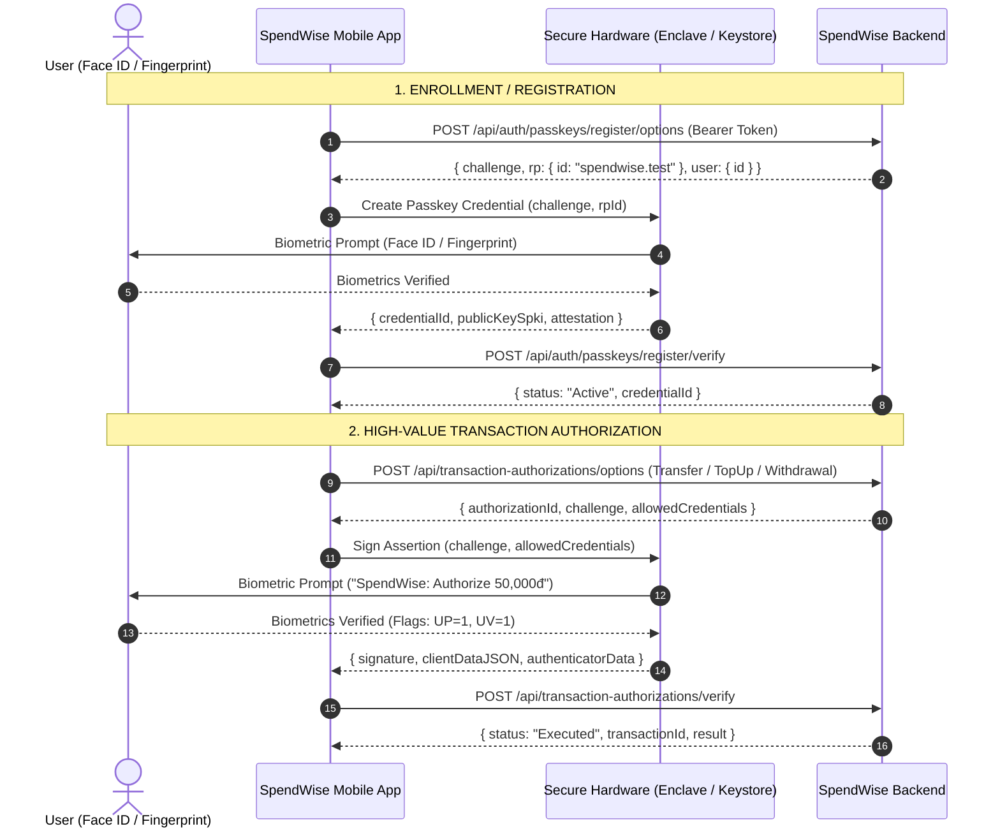

# SPENDWISE — FRONTEND & REAL DEVICE E2E VERIFICATION GUIDE
## Face ID (iOS) & Fingerprint (Android) | WebAuthn / FIDO2 Level 2

**Document Version:** 1.0  
**Target:** iOS 16+ (Apple Secure Enclave) & Android 9+ / API 28+ (Android Keystore / StrongBox)  
**Backend Endpoints:** `http://127.0.0.1:5158` (Local / Test Mode) | RP ID: `spendwise.test`

---

## 1. Overview for Frontend Mobile Developers

The SpendWise Backend implements standard **W3C WebAuthn / FIDO2 Level 2** cryptographic authentication.

> [!IMPORTANT]
> **No Biometric Data Leaves the Device.**  
> The backend **never** receives or stores face images, fingerprint scans, or private keys. The mobile OS Secure Hardware generates a keypair (`ES256` / P-256), stores the private key, and returns an assertion containing the cryptographic signature and authenticator data.

### Verification Flow Architecture



---

## 2. Real Device Implementation Details

### 2.1 iOS (Swift / SwiftUI) with AuthenticationServices

Use `ASAuthorizationController` and `ASAuthorizationPlatformPublicKeyCredentialProvider`:

#### Registration (Passkey Creation)
```swift
import AuthenticationServices

func registerPasskey(challenge: Data, userId: Data, userName: String) {
    let provider = ASAuthorizationPlatformPublicKeyCredentialProvider(relyingPartyIdentifier: "spendwise.test")
    let registrationRequest = provider.createCredentialRegistrationRequest(
        challenge: challenge,
        name: userName,
        userID: userId
    )
    
    let controller = ASAuthorizationController(authorizationRequests: [registrationRequest])
    controller.delegate = self
    controller.presentationContextProvider = self
    controller.performRequests()
}
```

#### Financial Transaction Assertion (Biometric Signing)
```swift
func authorizeTransaction(challenge: Data, allowedCredentialIds: [Data]) {
    let provider = ASAuthorizationPlatformPublicKeyCredentialProvider(relyingPartyIdentifier: "spendwise.test")
    let assertionRequest = provider.createCredentialAssertionRequest(challenge: challenge)
    assertionRequest.allowedCredentials = allowedCredentialIds.map {
        ASAuthorizationPlatformPublicKeyCredentialDescriptor(credentialID: $0)
    }
    assertionRequest.userVerificationPreference = .required // STRICT UV=1 for Financial Safety
    
    let controller = ASAuthorizationController(authorizationRequests: [assertionRequest])
    controller.delegate = self
    controller.presentationContextProvider = self
    controller.performRequests()
}
```

Extract the assertion properties from `ASAuthorizationPlatformPublicKeyCredentialAssertion`:
- `credentialID`: Base64Url encoded string.
- `rawClientDataJSON`: Base64Url encoded string.
- `rawAuthenticatorData`: Base64Url encoded string.
- `signature`: Base64Url encoded string.

---

### 2.2 Android (Kotlin) with Credential Manager

Use Android `androidx.credentials.CredentialManager`:

#### Registration (Passkey Creation)
```kotlin
import androidx.credentials.CredentialManager
import androidx.credentials.CreatePublicKeyCredentialRequest

val credentialManager = CredentialManager.create(context)
val requestJson = """
{
  "rp": { "name": "SpendWise", "id": "spendwise.test" },
  "user": { "id": "${base64UrlUserId}", "name": "${userEmail}", "displayName": "${userFullName}" },
  "challenge": "${challengeBase64Url}",
  "pubKeyCredParams": [{ "type": "public-key", "alg": -7 }],
  "authenticatorSelection": {
    "authenticatorAttachment": "platform",
    "requireResidentKey": true,
    "userVerification": "required"
  },
  "timeout": 60000
}
""".trimIndent()

val request = CreatePublicKeyCredentialRequest(requestJson)
val result = credentialManager.createCredential(context, request)
```

#### Financial Transaction Assertion (Biometric Signing)
```kotlin
import androidx.credentials.GetCredentialRequest
import androidx.credentials.GetPublicKeyCredentialOption

val optionJson = """
{
  "challenge": "${challengeBase64Url}",
  "rpId": "spendwise.test",
  "allowCredentials": [{ "type": "public-key", "id": "${credentialId}" }],
  "userVerification": "required",
  "timeout": 60000
}
""".trimIndent()

val getOption = GetPublicKeyCredentialOption(optionJson)
val request = GetCredentialRequest(listOf(getOption))
val result = credentialManager.getCredential(context, request)
```

---

## 3. API Contract Specifications

### 3.1 Passkey Registration
- **Step 1: Get Registration Options**
  - `POST /api/auth/passkeys/register/options`
  - Header: `Authorization: Bearer <accessToken>`
  - Response: `{ challenge: string, rpId: "spendwise.test", timeout: 120000, user: { ... } }`
- **Step 2: Verify Registration**
  - `POST /api/auth/passkeys/register/verify`
  - Header: `Authorization: Bearer <accessToken>`
  - Body:
    ```json
    {
      "challenge": "<challenge_from_step_1>",
      "credentialId": "<base64url_credential_id>",
      "publicKey": "<base64_spki_public_key>",
      "algorithm": "ES256",
      "deviceName": "iPhone 15 Pro Max (iOS 17.5)"
    }
    ```
  - Response (200 OK): `{ success: true, credentialId: string, status: "Active" }`

### 3.2 Quick Biometric Login
- **Step 1: Get Login Challenge**
  - `POST /api/auth/passkeys/login/options`
  - Body: `{ identifier: "user@spendwise.local" }`
  - Response: `{ challenge: string, rpId: "spendwise.test", timeout: 60000, allowedCredentials: [...] }`
- **Step 2: Verify Login Assertion**
  - `POST /api/auth/passkeys/login/verify`
  - Body:
    ```json
    {
      "credentialId": "<base64url_credential_id>",
      "signature": "<base64url_signature>",
      "clientDataJSON": "<base64url_clientDataJSON>",
      "authenticatorData": "<base64url_authenticatorData>"
    }
    ```
  - Response (200 OK): `{ accessToken: string, refreshToken: string, user: { ... } }`

### 3.3 Financial Transaction Biometric Authorization
- **Step 1: Prepare Intent & Challenge**
  - `POST /api/transaction-authorizations/options`
  - Header: `Authorization: Bearer <accessToken>`
  - Body:
    ```json
    {
      "transactionType": "InternalTransfer", // or "P2PTransfer", "FundContribution", "TopUp", "Withdrawal"
      "amount": 50000,
      "currency": "VND",
      "sourceId": "<source_wallet_or_bank_id>",
      "destinationId": "<dest_wallet_or_bank_or_fund_id>",
      "idempotencyKey": "tx_biometric_abc123"
    }
    ```
  - Response (200 OK):
    ```json
    {
      "authorizationId": "uuid",
      "challenge": "<base64url_challenge>",
      "expiresAt": "2026-10-27T16:45:00Z",
      "allowedCredentials": ["<credentialId_1>", "<credentialId_2>"]
    }
    ```
- **Step 2: Sign Biometric Assertion & Execute**
  - `POST /api/transaction-authorizations/verify`
  - Header: `Authorization: Bearer <accessToken>`
  - Body:
    ```json
    {
      "authorizationId": "<authorizationId_from_step_1>",
      "credentialId": "<base64url_credential_id>",
      "signature": "<base64url_signature>",
      "clientDataJSON": "<base64url_clientDataJSON>",
      "authenticatorData": "<base64url_authenticatorData>"
    }
    ```
  - Response (200 OK):
    ```json
    {
      "success": true,
      "authorizationId": "uuid",
      "status": "Executed",
      "transactionType": "InternalTransfer",
      "amount": 50000,
      "currency": "VND",
      "executedAt": "2026-10-27T16:45:10Z",
      "result": { ... }
    }
    ```

---

## 4. Physical Device E2E Verification Checklist

Before shipping to App Store / Google Play, the QA team must execute the following on **physical test devices**:

| Test ID | Scenario | Device / OS | Expected Result | Verified |
|---|---|---|---|---|
| **E2E-DEV-01** | First-time Face ID Enrollment | iPhone (iOS 16+) | System Face ID prompt appears; enrollment succeeds; credential stored in Keychain. | [ ] |
| **E2E-DEV-02** | First-time Fingerprint Enrollment | Android (API 30+) | System Biometric prompt appears; enrollment succeeds; credential stored in Keystore. | [ ] |
| **E2E-DEV-03** | Biometric Quick Login | iPhone / Android | App opens directly into Dashboard with valid JWT without entering Password or PIN. | [ ] |
| **E2E-DEV-04** | Biometric Internal Transfer | iPhone / Android | Prompt displays amount; Face ID/Fingerprint scan executes transfer atomically; balances update. | [ ] |
| **E2E-DEV-05** | Biometric P2P Transfer | iPhone / Android | Face ID/Fingerprint authorizes transfer; recipient receives funds instantly. | [ ] |
| **E2E-DEV-06** | Biometric SePay Top-Up Intent | iPhone / Android | Biometric authorization confirms intent; status remains `Pending` until SePay sandbox settlement. | [ ] |
| **E2E-DEV-07** | Biometric SePay Withdrawal | iPhone / Android | Biometric authorization reserves wallet balance; status becomes `Processing`. | [ ] |
| **E2E-DEV-08** | Biometric User Cancellation | iPhone / Android | User taps "Cancel" on Face ID/Fingerprint dialog; app gracefully retains screen state. | [ ] |
| **E2E-DEV-09** | Face ID Mismatch (Wrong Face) | iPhone | System fails Face ID; prompts retry; does NOT call backend verify endpoint on failure. | [ ] |
| **E2E-DEV-10** | Revocation & Fallback | iPhone / Android | User revokes biometric key in Profile; app falls back cleanly to Password + Security PIN. | [ ] |

---

## 5. Summary & Sign-off

- **Backend Readiness:** **100% COMPLETE & VERIFIED** (All 41 automated tests PASS).
- **Physical Device Status:** **DEVICE E2E PENDING** (To be validated on real test devices using the checklist above).
