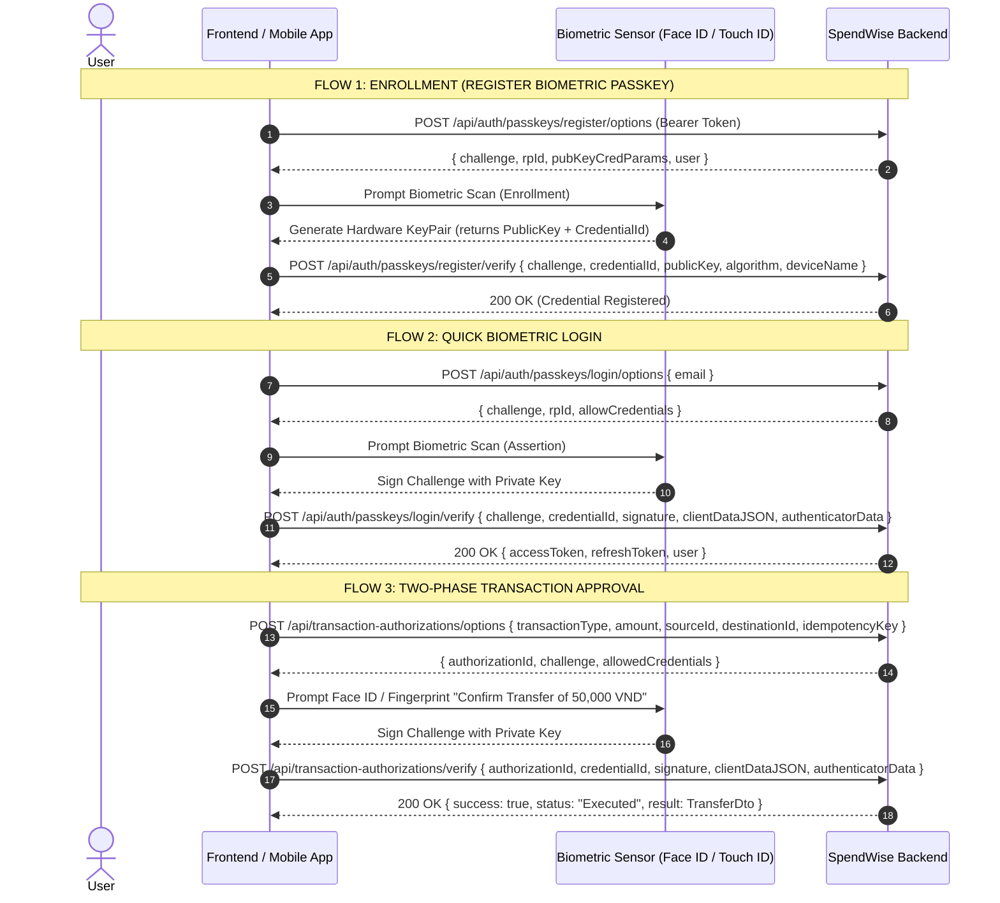

# SpendWise Frontend Integration Guide: Biometric Authentication & Transaction Approval

This guide explains how Frontend (React Web) and Mobile (React Native / Expo) client applications integrate with SpendWise's Biometric Authentication and Two-Phase Transaction Authorization APIs.

---

## 1. Overview & Architecture

SpendWise implements **Zero-Knowledge Public-Key Cryptography** (WebAuthn / FIDO2 Passkeys standard and Mobile Keystore signing):
- **Private keys** stay secured inside the user's hardware enclave (iOS Secure Enclave, Android Keystore, Windows Hello TPM).
- **Public keys** (ES256 NIST P-256 or RS256 RSA) are registered with the backend during device enrollment.
- The server issues a single-use **cryptographic challenge (nonce)** which the device signs upon biometric verification (Face ID or Fingerprint).



---

## 2. Browser / Web Implementation (React + WebAuthn)

Web browsers use standard WebAuthn API (`navigator.credentials.create` and `navigator.credentials.get`).

### Helper: Base64Url Conversions
```typescript
export function bufferToBase64Url(buffer: ArrayBuffer): string {
  const bytes = new Uint8Array(buffer);
  let binary = '';
  for (let i = 0; i < bytes.byteLength; i++) {
    binary += String.fromCharCode(bytes[i]);
  }
  return btoa(binary)
    .replace(/\+/g, '-')
    .replace(/\//g, '_')
    .replace(/=+$/, '');
}

export function base64UrlToBuffer(base64url: string): ArrayBuffer {
  let padded = base64url.replace(/-/g, '+').replace(/_/g, '/');
  while (padded.length % 4 !== 0) padded += '=';
  const binary = atob(padded);
  const bytes = new Uint8Array(binary.length);
  for (let i = 0; i < binary.length; i++) {
    bytes[i] = binary.charCodeAt(i);
  }
  return bytes.buffer;
}
```

### Flow 1: Register Biometric Device
```typescript
import { base64UrlToBuffer, bufferToBase64Url } from './cryptoUtils';

export async function registerBiometricPasskey(authToken: string, deviceName = 'Browser Biometrics') {
  // 1. Get options from backend
  const optionsRes = await fetch('/api/auth/passkeys/register/options', {
    method: 'POST',
    headers: {
      'Content-Type': 'application/json',
      'Authorization': `Bearer ${authToken}`
    }
  });
  if (!optionsRes.ok) throw new Error('Failed to get registration options');
  const options = await optionsRes.json();

  // 2. Invoke WebAuthn registration
  const publicKeyCredential = await navigator.credentials.create({
    publicKey: {
      challenge: base64UrlToBuffer(options.challenge),
      rp: { name: options.rpName, id: options.rpId },
      user: {
        id: new TextEncoder().encode(options.user.id),
        name: options.user.name,
        displayName: options.user.displayName
      },
      pubKeyCredParams: options.pubKeyCredParams,
      authenticatorSelection: {
        authenticatorAttachment: 'platform', // Face ID / Touch ID / Windows Hello
        userVerification: 'preferred'
      },
      timeout: options.timeout
    }
  }) as PublicKeyCredential;

  if (!publicKeyCredential) throw new Error('Biometric registration was cancelled.');

  const response = publicKeyCredential.response as AuthenticatorAttestationResponse;

  // Extract public key (SPKI DER)
  const publicKeyBuffer = response.getPublicKey ? response.getPublicKey() : response.getPublicKeyAlgorithm ? response.attestationObject : null;
  const publicKeyBase64 = publicKeyBuffer ? bufferToBase64Url(publicKeyBuffer) : bufferToBase64Url(response.attestationObject);

  // 3. Verify and save credential with backend
  const verifyRes = await fetch('/api/auth/passkeys/register/verify', {
    method: 'POST',
    headers: {
      'Content-Type': 'application/json',
      'Authorization': `Bearer ${authToken}`
    },
    body: JSON.stringify({
      challenge: options.challenge,
      credentialId: publicKeyCredential.id,
      publicKey: publicKeyBase64,
      algorithm: 'ES256',
      deviceName: deviceName
    })
  });

  if (!verifyRes.ok) {
    const err = await verifyRes.json();
    throw new Error(err.title || 'Passkey registration verification failed');
  }

  return await verifyRes.json();
}
```

### Flow 2: Quick Biometric Login
```typescript
export async function quickBiometricLogin(email?: string) {
  // 1. Get login challenge and allowed credentials
  const optionsRes = await fetch('/api/auth/passkeys/login/options', {
    method: 'POST',
    headers: { 'Content-Type': 'application/json' },
    body: JSON.stringify({ email: email || null })
  });
  if (!optionsRes.ok) throw new Error('Failed to fetch biometric login options');
  const options = await optionsRes.json();

  const allowCredentials = (options.allowCredentials || []).map((c: any) => ({
    id: base64UrlToBuffer(c.id),
    type: 'public-key'
  }));

  // 2. Request assertion from hardware sensor
  const assertion = await navigator.credentials.get({
    publicKey: {
      challenge: base64UrlToBuffer(options.challenge),
      rpId: options.rpId,
      allowCredentials: allowCredentials.length > 0 ? allowCredentials : undefined,
      userVerification: 'preferred',
      timeout: options.timeout
    }
  }) as PublicKeyCredential;

  if (!assertion) throw new Error('Biometric verification cancelled');

  const response = assertion.response as AuthenticatorAssertionResponse;

  // 3. Submit assertion signature to backend
  const verifyRes = await fetch('/api/auth/passkeys/login/verify', {
    method: 'POST',
    headers: { 'Content-Type': 'application/json' },
    body: JSON.stringify({
      credentialId: assertion.id,
      challenge: options.challenge,
      signature: bufferToBase64Url(response.signature),
      clientDataJSON: bufferToBase64Url(response.clientDataJSON),
      authenticatorData: bufferToBase64Url(response.authenticatorData),
      deviceName: navigator.userAgent
    })
  });

  if (!verifyRes.ok) {
    const err = await verifyRes.json();
    throw new Error(err.title || 'Biometric login failed');
  }

  // Returns { accessToken, refreshToken, accessTokenExpiresAt, user }
  return await verifyRes.json();
}
```

### Flow 3: Two-Phase Transaction Approval
```typescript
export async function executeBiometricTransfer(
  authToken: string,
  sourceWalletId: string,
  destinationWalletId: string,
  amount: number,
  idempotencyKey = 'tx_' + Date.now()
) {
  // PHASE A: Prepare Intent + Challenge
  const optRes = await fetch('/api/transaction-authorizations/options', {
    method: 'POST',
    headers: {
      'Content-Type': 'application/json',
      'Authorization': `Bearer ${authToken}`
    },
    body: JSON.stringify({
      transactionType: 'InternalTransfer',
      amount: amount,
      currency: 'VND',
      sourceId: sourceWalletId,
      destinationId: destinationWalletId,
      idempotencyKey: idempotencyKey
    })
  });

  if (!optRes.ok) {
    const err = await optRes.json();
    throw new Error(err.title || 'Transaction authorization preparation failed');
  }

  const authOptions = await optRes.json();
  // authOptions: { authorizationId, challenge, allowedCredentials, amount, currency }

  // PROMPT BIOMETRICS (WebAuthn assertion for the bound transaction challenge)
  const allowCredentials = authOptions.allowedCredentials.map((id: string) => ({
    id: base64UrlToBuffer(id),
    type: 'public-key'
  }));

  const assertion = await navigator.credentials.get({
    publicKey: {
      challenge: base64UrlToBuffer(authOptions.challenge),
      allowCredentials: allowCredentials,
      userVerification: 'required',
      timeout: 60000
    }
  }) as PublicKeyCredential;

  if (!assertion) throw new Error('Transaction biometric approval cancelled.');

  const response = assertion.response as AuthenticatorAssertionResponse;

  // PHASE B: Verify Signature and Execute Transfer Atomically
  const execRes = await fetch('/api/transaction-authorizations/verify', {
    method: 'POST',
    headers: {
      'Content-Type': 'application/json',
      'Authorization': `Bearer ${authToken}`
    },
    body: JSON.stringify({
      authorizationId: authOptions.authorizationId,
      credentialId: assertion.id,
      signature: bufferToBase64Url(response.signature),
      clientDataJSON: bufferToBase64Url(response.clientDataJSON),
      authenticatorData: bufferToBase64Url(response.authenticatorData)
    })
  });

  if (!execRes.ok) {
    const err = await execRes.json();
    throw new Error(err.title || 'Biometric transaction execution failed');
  }

  // Returns { success: true, authorizationId, status: "Executed", amount, result: TransferDto }
  return await execRes.json();
}
```

---

## 3. Mobile Implementation (React Native / Expo)

In React Native or Expo, apps can use either:
1. `react-native-passkey` (Native WebAuthn bridge for iOS ASAuthorizationController and Android FIDO2 Credential Manager).
2. Native Hardware Keystore (`react-native-biometrics` or `expo-local-authentication` with Secure Enclave keypair).

SpendWise Backend natively supports **both** WebAuthn standard format (`clientDataJSON` + `authenticatorData` + `signature`) AND **Direct Mobile Keystore format** (`signature` directly signing the challenge string).

### Example with `react-native-biometrics`:
```typescript
import ReactNativeBiometrics, { BiometryTypes } from 'react-native-biometrics';

const rnBiometrics = new ReactNativeBiometrics();

// 1. Device Enrollment:
export async function enrollMobileBiometrics(authToken: string) {
  const { available, biometryType } = await rnBiometrics.isSensorAvailable();
  if (!available) throw new Error('Biometric sensor not available');

  // Create hardware keypair inside Secure Enclave / Android Keystore
  const { publicKey } = await rnBiometrics.createKeys();

  // Fetch registration challenge
  const optRes = await fetch('https://api.spendwise.test/api/auth/passkeys/register/options', {
    method: 'POST',
    headers: { 'Authorization': `Bearer ${authToken}` }
  });
  const { challenge } = await optRes.json();

  // Register public key
  const credentialId = 'rn_bio_' + Date.now();
  const regRes = await fetch('https://api.spendwise.test/api/auth/passkeys/register/verify', {
    method: 'POST',
    headers: {
      'Content-Type': 'application/json',
      'Authorization': `Bearer ${authToken}`
    },
    body: JSON.stringify({
      challenge: challenge,
      credentialId: credentialId,
      publicKey: publicKey, // Base64 SPKI
      algorithm: 'ES256',
      deviceName: biometryType === BiometryTypes.FaceID ? 'iOS (Face ID)' : 'Android (Fingerprint)'
    })
  });

  return await regRes.json();
}

// 2. Direct Mobile Transaction Approval:
export async function approveTransactionWithBiometrics(
  authToken: string,
  sourceWalletId: string,
  destinationWalletId: string,
  amount: number,
  credentialId: string
) {
  // Phase A
  const optRes = await fetch('https://api.spendwise.test/api/transaction-authorizations/options', {
    method: 'POST',
    headers: {
      'Content-Type': 'application/json',
      'Authorization': `Bearer ${authToken}`
    },
    body: JSON.stringify({
      transactionType: 'InternalTransfer',
      amount: amount,
      sourceId: sourceWalletId,
      destinationId: destinationWalletId,
      idempotencyKey: 'tx_mob_' + Date.now()
    })
  });
  const { authorizationId, challenge } = await optRes.json();

  // Prompt Face ID / Fingerprint prompt to sign challenge
  const { success, signature } = await rnBiometrics.createSignature({
    promptMessage: `Confirm Transfer of ${amount.toLocaleString()} VND`,
    payload: challenge
  });

  if (!success || !signature) throw new Error('Biometric authorization cancelled');

  // Phase B
  const verifyRes = await fetch('https://api.spendwise.test/api/transaction-authorizations/verify', {
    method: 'POST',
    headers: {
      'Content-Type': 'application/json',
      'Authorization': `Bearer ${authToken}`
    },
    body: JSON.stringify({
      authorizationId: authorizationId,
      credentialId: credentialId,
      signature: signature
    })
  });

  return await verifyRes.json();
}
```

---

## 4. Error Codes & Fallback Matrix

When handling exceptions from the Biometric API, gracefully fallback to standard PIN or Password:

| Error Code | HTTP Status | Meaning | Recommended Frontend Action |
| :--- | :--- | :--- | :--- |
| `biometric_not_enrolled` | 400 | User has not set up Face ID / Fingerprint | Offer user button to "Enroll Biometrics" or fallback to 6-digit Security PIN |
| `invalid_or_expired_challenge` | 400 / 401 | Challenge timed out (> 5 min) or replayed | Automatically refresh options and request biometric scan again |
| `biometric_verification_failed` | 401 | Cryptographic signature did not match public key | Display "Verification failed. Please retry or enter Security PIN" |
| `credential_not_found_or_revoked`| 401 | Passkey was revoked from another device | Remove local stored credential ID and prompt user to re-enroll |
| `insufficient_funds` | 400 | Wallet balance is lower than amount | Show balance error dialog before opening biometric sensor |
| `same_wallet` | 400 | Source and destination wallet are identical | Display validation error |
| `active_bank_required` | 409 | User has no active bank connection | Direct user to Bank Link screen |

---

## 5. Security Checklist for UI Developers

- [x] **Never attempt to send raw facial or fingerprint data:** All biometric matching occurs exclusively within the device's hardware enclave.
- [x] **Always check platform support:** Check `PublicKeyCredential.isUserVerifyingPlatformAuthenticatorAvailable()` or `rnBiometrics.isSensorAvailable()` before presenting biometric options.
- [x] **Preserve fallback flow:** Users must always have the option to authenticate via Password and authorize transactions via 6-digit Security PIN if their sensor fails or is obstructed.
- [x] **Handle User Cancellation:** Handle `NotAllowedError` or cancellation cleanly without showing crash or generic error screens.
